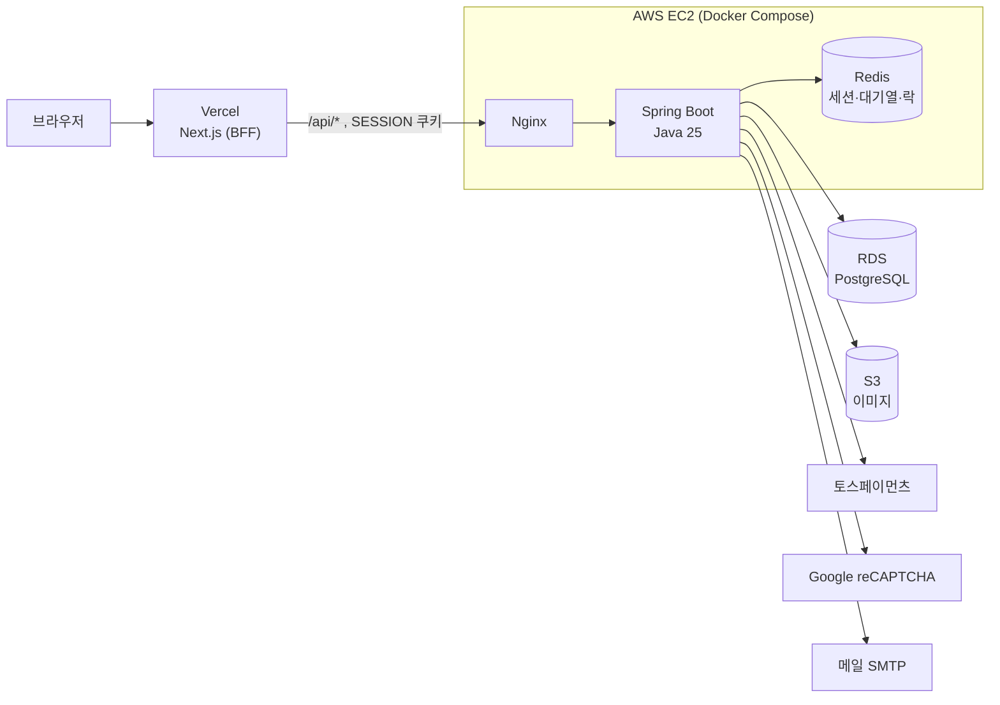

# tickting

공연 티켓 예매 서비스입니다. 예매자는 공연을 찾아 좌석을 고르고 결제하고, 판매자는 공연을 등록해 팝니다. 관리자는 판매자 승인과 환불·문의를 처리합니다.

인기 공연이 열리는 순간 사람이 몰려도 **좌석이 두 번 팔리지 않고, 매크로가 줄을 새치기하지 못하게** 하는 데 집중했습니다.

- **좌석 동시성**: Redis 분산락 + DB 상태 조건부 UPDATE + UNIQUE 인덱스로 같은 좌석의 중복 점유를 막습니다.
- **대기열**: 예매하기를 누르면 Redis 대기열에 줄을 서고, 입장한 사람만 좌석을 고를 수 있습니다.
- **매크로 방어**: 대기열 입장과 인증번호 발송에 reCAPTCHA v3를 겁니다.
- **결제**: 토스페이먼츠로 결제·환불하고, 응답이 끊긴 결제는 스케줄러가 토스에 다시 물어 맞춥니다.

## 서비스 링크

| | 주소 |
|---|---|
| 웹 | https://noresell.store |
| API 서버 | https://api.noresell.store |

> API 서버는 비용 때문에 **09~18시에만 켜 둡니다.** 그 밖의 시간에는 웹이 열려도 데이터가 나오지 않습니다.

## 시스템 아키텍처



- 브라우저는 Spring을 직접 부르지 않고 Next.js 서버(BFF)를 거칩니다. 로그인은 Redis 세션(`SESSION` 쿠키)입니다.
- 앱은 상태를 갖지 않아 여러 대로 늘릴 수 있습니다. (내 PC에서 앱 2대 + Nginx로 확인: [doc/local-multi-server.md](doc/local-multi-server.md))

**CI/CD** (GitHub Actions)

```
PR, dev 머지  → 빌드 + 전체 테스트(Testcontainers) + JaCoCo 커버리지
main 머지     → 이미지 빌드 → Docker Hub → EC2에서 deploy.sh로 교체 (실패하면 이전 이미지로 되돌림)
client 변경   → Vercel CLI로 프론트 배포
```

## 사용 방법

**예매자**
1. 이메일 인증 후 가입하고 로그인합니다.
2. 공연을 검색해 회차를 고르고 **예매하기**를 누르면 대기열에 섭니다.
3. 입장하면 구역 → 좌석을 고르고, 제한 시간 안에 토스로 결제합니다.
4. 내 예매에서 상세를 보고 전체·일부 취소(취소 규정에 따라 환불)를 할 수 있습니다. 궁금한 점은 문의로 남깁니다.

**판매자**
1. 사업체 정보로 가입을 신청하고, 관리자 승인을 받으면 로그인할 수 있습니다.
2. 공연장을 골라 공연을 등록하고 등급·가격, 회차, 취소 규정을 정한 뒤 공개합니다.
3. 판매 현황과 예매 목록을 보고, 회차를 판매 중지·연기·취소할 수 있습니다. 담당자를 초대해 함께 관리합니다.

**관리자**
- 판매자 사업체 승인·반려, 공연장 사용 중지·재개, 환불 실패 재처리, 문의 답변을 합니다.

## 더 보기

| 문서 | 내용 |
|---|---|
| [doc/api-spec.md](doc/api-spec.md) | API 명세 |
| [doc/](doc/) `part1~5` | 설계 (테이블·흐름·정책) |
| [doc/queue-design.md](doc/queue-design.md) | 대기열 설계 |
| [client/README.md](client/README.md) | 프론트 실행·배포 |
