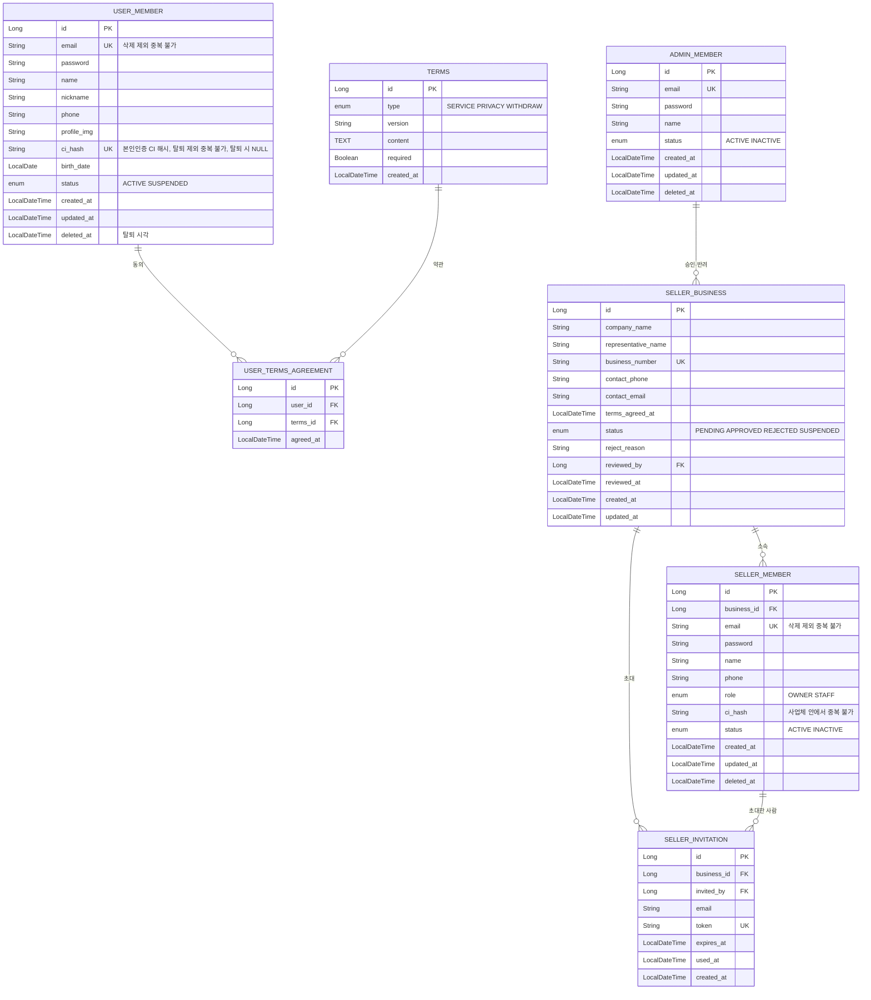

# 1부. 유저 영역 (예매자 · 판매자 · 관리자)

> 이 부에서 다루는 테이블은 **7개**입니다.
> `user_member`, `terms`, `user_terms_agreement`, `seller_business`, `seller_member`, `seller_invitation`, `admin_member`
>
> 읽고 나면 알게 되는 것
> - 서비스를 쓰는 사람이 왜 3종류이고, 왜 테이블이 따로인지
> - 회원가입, 판매자 가입, 담당자 초대가 어떤 테이블을 어떻게 쓰는지

**컬럼 표 읽는 법**: 열쇠 아이콘은 키입니다. 금색 = **PK**(이 테이블의 고유 번호), 분홍색 = **FK**(다른 테이블의 번호를 가리키는 컬럼). 타입은 자바 기준이고, NULL은 "비워 둬도 되는지"입니다. 모든 테이블 그림은 따로 이미지(`p1-*.png`)로도 있습니다.

> 예매자 테이블(`user_member`, 약관)은 팀원이 맡은 부분이라, `name`, `ci_hash` 추가는 팀원과 맞춰야 합니다.

---

## 이 부의 ERD



---

## 1-1. 서비스를 쓰는 사람은 3종류입니다

| | 예매자 | 판매자 | 관리자 |
|---|---|---|---|
| 누구인가 | 티켓을 사는 일반 사용자 | 공연을 올리는 기획사 직원 | 서비스 운영자 (몇 명뿐) |
| 어떻게 생기나 | 직접 회원가입 | 가입 신청 → 관리자 승인 | 개발할 때 시드로 미리 등록 |
| 소속 | 없음 | **사업체(회사)에 소속** | 없음 |
| 테이블 | `user_member` | `seller_business` + `seller_member` | `admin_member` |

**Q. 회원 테이블 하나에 "역할" 컬럼으로 구분하면 안 되나요?**

가능하지만, 세 종류는 가입 정보부터 다릅니다. 예매자에게는 사업자번호가 없고, 판매자에게는 회사 소속이 필요하고, 관리자는 가입 자체가 없습니다. 한 테이블에 합치면 비는 칸이 많아지고 권한 체크가 꼬이기 쉽습니다. 그래서 **세 종류를 완전히 따로** 만들었습니다.

**완전히 따로라는 것의 뜻**

- 같은 사람이 예매자 계정과 판매자 계정을 **각각 따로** 만들 수 있습니다. 서로 중복 검사를 하지 않습니다.
- 이메일(로그인 아이디)이 예매자 테이블과 판매자 테이블에서 겹쳐도 됩니다. 로그인 화면(주소)이 따로라서 구분됩니다.

**Q. 요청이 들어올 때 누구인지는 어떻게 아나요?**

로그인하면 JWT 토큰을 주고, 그 안에 **계정 종류**(예매자/판매자/관리자)를 담습니다. 판매자라면 **역할**(대표자/담당자)과 **사업체 번호**도 담습니다. 서버는 이 토큰을 보고 "이 요청은 어느 종류의 누가 보냈는지" 판단합니다. 주소별로 `/admin/**`은 관리자만, `/seller/**`는 판매자만 들어올 수 있게 나눕니다.

---

## 1-2. 예매자: `user_member`와 약관 두 테이블

### user_member (회원, 예매자)

**Q. 이 테이블에는 무엇을 저장하나요?**

로그인 정보(이메일, 암호화된 비밀번호)와 본인인증으로 확인된 정보(이름, 휴대폰), 화면에 보이는 정보(닉네임, 프로필 이미지), 그리고 상태입니다.

**회원 (예매자)** · `user_member`

| 키 | 한글명 | 컬럼 | 타입 | NULL | 설명 |
|---|---|---|---|---|---|
| PK | 회원 번호 | `id` | Long | NOT NULL | 회원 고유 번호 |
|  | 이메일 | `email` | String | NOT NULL | 로그인 아이디. 삭제되지 않은 회원끼리 중복 불가 |
|  | 비밀번호 | `password` | String | NOT NULL | 암호화(BCrypt)한 값을 저장 |
|  | 이름 | `name` | String | NOT NULL | 본인인증으로 확인된 실명. 주문자 정보에 사용 |
|  | 닉네임 | `nickname` | String | NOT NULL | 화면에 보이는 이름 |
|  | 휴대폰 번호 | `phone` | String | NOT NULL |  |
|  | 프로필 이미지 | `profile_img` | String | NULL | 이미지 주소 |
|  | 본인인증 고유값 | `ci_hash` | String | NULL | CI를 해시한 값. 탈퇴하지 않은 회원끼리 중복 불가 (1인 1계정). 가입할 때는 필수이고, 탈퇴하면 비움 |
|  | 생년월일 | `birth_date` | LocalDate | NULL | 관람 연령 확인용 (선택) |
|  | 상태 | `status` | enum | NOT NULL | ACTIVE 사용 중 / SUSPENDED 이용 제한 [확장] |
|  | 생성일 | `created_at` | LocalDateTime | NOT NULL |  |
|  | 수정일 | `updated_at` | LocalDateTime | NOT NULL |  |
|  | 삭제일 | `deleted_at` | LocalDateTime | NULL | 탈퇴 시각. 값이 있으면 탈퇴한 회원 |

**Q. 이름(`name`)과 닉네임(`nickname`)이 왜 둘 다 있나요?**

닉네임은 화면에 보이는 이름이고, 이름은 본인인증으로 확인된 실명입니다. 예매할 때 **주문자 정보를 자동으로 채워 주려면 실명이 필요**합니다. 닉네임으로는 채울 수 없습니다.

**Q. `ci_hash`는 왜 있나요? id로 구분하면 되지 않나요?**

`id`는 우리 DB가 계정마다 붙이는 번호라서, 같은 사람이 계정을 두 번 만들면 다른 번호가 붙습니다. id만으로는 같은 사람인지 알 수 없습니다. CI는 본인인증 기관이 사람마다 주는 고유값이라, 이것을 해시해서 중복 불가로 걸면 **한 사람이 계정을 여러 개 만드는 것**을 막을 수 있습니다. 티켓 매크로 방어와도 이어집니다. 원문 CI는 저장하지 않습니다.

**Q. 탈퇴하면 행을 지우나요?**

지우지 않습니다. `deleted_at`에 탈퇴 시각을 남깁니다. 예매 내역이 이 회원을 가리키고 있어서, 행을 지우면 과거 예매 기록이 끊어집니다. `status`는 탈퇴가 아니라 **이용 제한**(의심 계정, 확장 기능)에 씁니다.

**Q. 행이 남아 있으면 개인정보도 계속 남지 않나요?**

그래서 **탈퇴할 때 개인정보를 비식별 처리**합니다. 행은 남기되 사람을 알아볼 수 있는 값은 지웁니다.

| 컬럼 | 탈퇴 시 처리 |
|---|---|
| `email` | `deleted-{id}@withdrawn.invalid` 같은 의미 없는 값으로 교체 |
| `password` | 로그인할 수 없는 무효한 값으로 교체 |
| `name`, `nickname` | `탈퇴회원` |
| `phone` | 빈 값(`-`) |
| `profile_img`, `birth_date` | NULL |
| `ci_hash` | **NULL** (그래서 같은 사람이 다시 가입할 수 있음) |

예매할 때의 이름·연락처는 `booking`에 **스냅샷**으로 따로 남아 있어서, 거래 기록은 유지됩니다. (거래 기록의 보관 기간과 범위는 실제 서비스라면 법적 기준을 확인해야 합니다.)

> ⚠️ **탈퇴 회원과 이메일**: 탈퇴한 행이 남아 있으면 같은 이메일로 다시 가입할 수 없게 됩니다. PostgreSQL에서는 "삭제되지 않은 행끼리만 중복 불가"로 걸 수 있습니다.
>
> ```sql
> CREATE UNIQUE INDEX uq_user_email ON user_member (email) WHERE deleted_at IS NULL;
> ```
>
> `ci_hash`도 같은 방식입니다. 그냥 UNIQUE로 걸면 탈퇴한 사람이 다시 가입할 수 없습니다. (NULL은 서로 중복으로 보지 않아서 탈퇴 회원은 걸리지 않습니다.)
>
> ```sql
> CREATE UNIQUE INDEX uq_user_ci ON user_member (ci_hash) WHERE deleted_at IS NULL;
> ```
>
> ⚠️ **JPA 소프트 삭제 필터**: `@SQLRestriction("deleted_at is null")`을 엔티티 전체에 걸면 탈퇴한 회원이 조회되지 않습니다. 그러면 예매 내역에서 회원을 가져올 때 값이 비어 오류가 날 수 있습니다. 전역 필터로 걸지 말고 필요한 조회에만 조건을 씁니다.

### terms와 user_terms_agreement (약관)

**Q. 왜 테이블이 2개인가요?**

- `terms`는 **약관 본문**입니다. 서비스 이용약관, 개인정보 동의, 탈퇴 약관이 버전별로 들어갑니다.
- `user_terms_agreement`는 **"누가 어떤 약관에 언제 동의했는지"** 기록입니다.

약관이 개정되면 옛 약관을 지우지 않고 **새 버전 행을 추가**합니다. 그래야 "그때 그 사람이 동의한 내용"이 남습니다. 회원과 약관이 다대다 관계라서 둘을 이어 주는 테이블이 필요합니다.

**약관** · `terms`

| 키 | 한글명 | 컬럼 | 타입 | NULL | 설명 |
|---|---|---|---|---|---|
| PK | 약관 번호 | `id` | Long | NOT NULL |  |
|  | 종류 | `type` | enum | NOT NULL | SERVICE 서비스 이용 / PRIVACY 개인정보 / WITHDRAW 탈퇴 |
|  | 버전 | `version` | String | NOT NULL | 개정하면 새 행을 추가 |
|  | 본문 | `content` | TEXT | NOT NULL | 약관 전문 |
|  | 필수 여부 | `required` | Boolean | NOT NULL | 필수면 동의하지 않을 때 가입 불가 |
|  | 생성일 | `created_at` | LocalDateTime | NOT NULL |  |

**약관 동의** · `user_terms_agreement`

| 키 | 한글명 | 컬럼 | 타입 | NULL | 설명 |
|---|---|---|---|---|---|
| PK | 동의 번호 | `id` | Long | NOT NULL |  |
| FK | 회원 번호 | `user_id` | Long | NOT NULL | 동의한 회원 (user_member) |
| FK | 약관 번호 | `terms_id` | Long | NOT NULL | 동의한 약관 (terms) |
|  | 동의일 | `agreed_at` | LocalDateTime | NOT NULL | 동의한 시각 |

---

## 1-3. 판매자: 회사와 계정을 나눈 이유

### 먼저 큰 그림

판매자는 "한 사람"이 아니라 **회사 1개 + 그 회사의 계정 여러 개**입니다.

```
seller_business (회사 1개)
 ├── seller_member  대표자 (OWNER)   ← 회사당 1명
 ├── seller_member  담당자 (STAFF)
 └── seller_member  담당자 (STAFF)
```

**Q. 왜 회사와 계정을 나눴나요? 대표자가 곧 회사 아닌가요?**

사용자 눈에는 대표자 계정이 곧 회사입니다. 그런데 DB에서는 **공연과 정산의 주인이 회사**여야 합니다. 담당자가 퇴사해서 계정이 비활성화돼도 그 사람이 올린 공연은 회사 것으로 남아야 하기 때문입니다. 그래서 회사 정보는 `seller_business`에 한 줄, 로그인하는 사람들은 `seller_member`에 여러 줄로 둡니다.

### seller_business (판매자 사업체)

**판매자 사업체** · `seller_business`

| 키 | 한글명 | 컬럼 | 타입 | NULL | 설명 |
|---|---|---|---|---|---|
| PK | 사업체 번호 | `id` | Long | NOT NULL |  |
|  | 사업체명 | `company_name` | String | NOT NULL | 기획사(회사) 이름 |
|  | 대표자명 | `representative_name` | String | NOT NULL | 본인인증된 이름과 같아야 함 |
|  | 사업자등록번호 | `business_number` | String | NOT NULL | 중복 불가 (같은 사업자 중복 가입 방지) |
|  | 연락처 | `contact_phone` | String | NOT NULL | 담당자 연락처 |
|  | 연락 이메일 | `contact_email` | String | NOT NULL | 담당자 이메일 |
|  | 약관 동의일 | `terms_agreed_at` | LocalDateTime | NOT NULL | 판매자 가입 때 동의한 시각 |
|  | 상태 | `status` | enum | NOT NULL | PENDING 승인 대기 / APPROVED 승인 / REJECTED 반려 / SUSPENDED 이용 정지 [확장] |
|  | 반려 사유 | `reject_reason` | String | NULL | 반려일 때만 값이 있음 |
| FK | 처리한 관리자 | `reviewed_by` | Long | NULL | 승인·반려한 관리자 (admin_member) |
|  | 처리일 | `reviewed_at` | LocalDateTime | NULL | 승인·반려한 시각 |
|  | 생성일 | `created_at` | LocalDateTime | NOT NULL |  |
|  | 수정일 | `updated_at` | LocalDateTime | NOT NULL |  |

### seller_member (판매자 계정)

**판매자 계정** · `seller_member`

| 키 | 한글명 | 컬럼 | 타입 | NULL | 설명 |
|---|---|---|---|---|---|
| PK | 계정 번호 | `id` | Long | NOT NULL |  |
| FK | 사업체 번호 | `business_id` | Long | NOT NULL | 소속 회사 (seller_business) |
|  | 이메일 | `email` | String | NOT NULL | 로그인 아이디. 삭제되지 않은 판매자 계정끼리 중복 불가 |
|  | 비밀번호 | `password` | String | NOT NULL | 암호화한 값을 저장 |
|  | 이름 | `name` | String | NOT NULL |  |
|  | 휴대폰 번호 | `phone` | String | NOT NULL |  |
|  | 역할 | `role` | enum | NOT NULL | OWNER 대표자 / STAFF 담당자 |
|  | 본인인증 고유값 | `ci_hash` | String | NOT NULL | CI 해시. 같은 사업체 안에서 중복 불가 |
|  | 상태 | `status` | enum | NOT NULL | ACTIVE 사용 중 / INACTIVE 비활성 |
|  | 생성일 | `created_at` | LocalDateTime | NOT NULL |  |
|  | 수정일 | `updated_at` | LocalDateTime | NOT NULL |  |
|  | 삭제일 | `deleted_at` | LocalDateTime | NULL | 담당자는 삭제하지 않고 비활성화만 하므로 쓰지 않음 |

- 대표자, 담당자 **모두 본인인증**을 하고 `ci_hash`를 저장합니다.
- `ci_hash`는 **같은 사업체 안에서** 중복 불가입니다. 같은 사람이 한 회사에 두 번 가입하는 것만 막고, 다른 회사에 가입하는 것은 막지 않습니다. (`business_id` + `ci_hash` 조합에 중복 불가)
- 담당자는 **삭제하지 않고 비활성화**만 합니다. 그래서 `deleted_at`은 공통 컬럼으로만 두고 담당자에게는 쓰지 않습니다. (삭제 = `deleted_at`, 비활성 = `status`)

### 판매자 가입 신청 흐름 (대표자)

1. 대표자가 **본인인증**을 합니다.
2. 회사 정보(사업체명, 사업자번호 등)를 입력하고 약관에 동의합니다.
3. 서버가 `seller_business`(**승인 대기**)와 `seller_member`(**대표자**)를 **한꺼번에 만듭니다.**
4. 승인 전에는 로그인할 수 없습니다 (회사 상태가 승인이 아니면 차단).
5. 관리자가 승인하면 회사 상태가 **승인**으로 바뀌고 로그인이 가능해집니다.
6. 반려하면 **반려**와 사유가 남습니다. 반려된 사업체는 같은 사업자번호로 **다시 신청할 수 없습니다.** (사업자번호 중복 검사가 상태와 상관없이 막습니다. 2026-11-13에 재신청을 지원하지 않기로 했습니다) 이의가 있으면 문의합니다. 문의 방법은 나중에 정합니다.

**Q. 왜 신청할 때 계정을 같이 만드나요?**

승인할 때 새로 만드는 방식보다 단순합니다. 비밀번호 등 입력한 정보를 따로 보관했다가 옮길 필요 없이, 만들어 둔 계정의 로그인만 회사 상태로 막았다 풀면 됩니다.

### seller_invitation (담당자 초대)

**Q. 담당자는 어떻게 회사에 들어오나요?**

대표자가 담당자의 이메일로 **초대 링크**를 보냅니다. 링크에는 한 번만 쓸 수 있는 토큰이 들어 있고, 담당자는 이 링크로 들어와 계정을 만듭니다. 사업체 목록을 보여주고 고르는 방식은 어떤 회사가 있는지 노출되기 때문에 쓰지 않습니다.

**담당자 초대** · `seller_invitation`

| 키 | 한글명 | 컬럼 | 타입 | NULL | 설명 |
|---|---|---|---|---|---|
| PK | 초대 번호 | `id` | Long | NOT NULL |  |
| FK | 사업체 번호 | `business_id` | Long | NOT NULL | 어느 회사의 초대인지 (seller_business) |
| FK | 초대한 사람 | `invited_by` | Long | NOT NULL | 초대한 대표자 (seller_member) |
|  | 초대 이메일 | `email` | String | NOT NULL | 초대받는 사람의 이메일 |
|  | 토큰 | `token` | String | NOT NULL | 초대 링크에 들어가는 고유 값, 중복 불가 |
|  | 만료일 | `expires_at` | LocalDateTime | NOT NULL | 링크 만료 시각 |
|  | 사용일 | `used_at` | LocalDateTime | NULL | 링크를 사용한 시각. 값이 있으면 재사용 불가 |
|  | 생성일 | `created_at` | LocalDateTime | NOT NULL |  |

**담당자 가입 흐름**

1. 대표자가 담당자 이메일을 입력합니다 → `seller_invitation`이 만들어지고 링크가 메일로 나갑니다.
2. 담당자가 링크로 접속합니다 → 서버가 토큰이 **존재하는지, 만료되지 않았는지, 이미 쓰지 않았는지** 확인합니다.
3. 담당자가 **본인인증**을 하고 계정 정보를 입력합니다.
4. `seller_member`(**담당자**, 사용 중)가 만들어지고, 초대의 `used_at`에 시각이 기록됩니다.

**담당자 비활성화**: 대표자가 담당자를 비활성화하면 `status`만 바뀝니다. 삭제하지 않으므로 그 사람의 과거 작업 이력이 남습니다. 대표자 본인은 비활성화할 수 없습니다.

---

## 1-4. 관리자: `admin_member`

**Q. 관리자는 가입하나요?**

가입이 없습니다. 개발할 때 시드 데이터로 1~2명을 넣고 끝입니다. 비밀번호 변경 기능도 없습니다.

**관리자** · `admin_member`

| 키 | 한글명 | 컬럼 | 타입 | NULL | 설명 |
|---|---|---|---|---|---|
| PK | 관리자 번호 | `id` | Long | NOT NULL |  |
|  | 이메일 | `email` | String | NOT NULL | 로그인 아이디 |
|  | 비밀번호 | `password` | String | NOT NULL | 암호화한 값을 저장 |
|  | 이름 | `name` | String | NOT NULL |  |
|  | 상태 | `status` | enum | NOT NULL | ACTIVE 사용 중 / INACTIVE 사용 중지 |
|  | 생성일 | `created_at` | LocalDateTime | NOT NULL |  |
|  | 수정일 | `updated_at` | LocalDateTime | NOT NULL |  |
|  | 삭제일 | `deleted_at` | LocalDateTime | NULL | 시드 계정이라 보통 쓰지 않음 |

---

## 1-5. 이 영역의 기능과 테이블 연결

| 기능 | 쓰는 테이블 | 핵심 동작 |
|---|---|---|
| 예매자 회원가입 | `user_member`, `user_terms_agreement` (`terms` 조회) | 본인인증, 이메일 중복 확인, 필수 약관 동의 확인, `ci_hash` 중복이면 가입 불가 |
| 예매자 로그인 | `user_member` | 비밀번호 확인, 상태가 사용 중이고 탈퇴하지 않은 회원만 JWT 발급 |
| 예매자 탈퇴 | `user_member` | `deleted_at` 기록, 개인정보 비식별 처리, `ci_hash` 비움, 토큰 블랙리스트 처리 |
| 판매자 가입 신청 | `seller_business`, `seller_member` | 본인인증 이름과 대표자명 일치 확인, 사업자번호 중복 확인, 둘을 한 번에 저장 |
| 판매자 승인·반려 | `seller_business` | 상태 변경, 처리한 관리자와 시각 기록, 반려면 사유 저장 |
| 판매자 로그인 | `seller_member`, `seller_business` | 회사가 승인이고 계정이 사용 중일 때만 JWT 발급 |
| 담당자 초대 | `seller_invitation` | 토큰 생성, 만료 시각 설정, 메일 발송 (대표자만) |
| 담당자 가입 | `seller_invitation`, `seller_member` | 토큰 검증, 본인인증, 담당자 생성, `used_at` 기록 |
| 담당자 비활성화 | `seller_member` | 상태를 비활성으로 변경 (대표자만), 토큰 블랙리스트 처리 |
| 관리자 로그인 | `admin_member` | 비밀번호 확인 후 JWT 발급 |

한 기능이 테이블을 **1~3개** 같이 건드립니다. 예를 들어 "판매자 가입 신청"은 `seller_business`와 `seller_member`에 같이 저장하는 하나의 작업이고, 둘 중 하나만 저장되면 안 되므로 한 트랜잭션으로 묶습니다.

**비활성화한 계정의 토큰**: 담당자를 비활성화해도 이미 발급된 JWT는 만료 전까지 쓸 수 있습니다. 그래서 토큰 만료를 짧게 두고, 비활성화한 계정의 토큰은 Redis 블랙리스트에 올려 바로 막습니다.

---

## 1부 요약

- 사용자는 예매자, 판매자, 관리자 3종류이고 **완전히 따로** 만든다. (서로 중복 검사 없음)
- 로그인은 이메일로 한다. 예매자는 본인인증으로 이름과 CI를 저장해 1인 1계정을 지킨다.
- 판매자는 **회사(`seller_business`) + 계정(`seller_member`)** 구조다. 대표자는 회사당 1명, 담당자는 초대 링크로 들어온다.
- 삭제하지 않는다. 회원 탈퇴는 `deleted_at`, 담당자 비활성화는 `status`로 처리한다. 탈퇴할 때는 개인정보를 비식별 처리하고 `ci_hash`를 비운다.

다음은 **2부. 공연장 영역** (`venue`, `venue_zone`, `venue_seat`)입니다.
