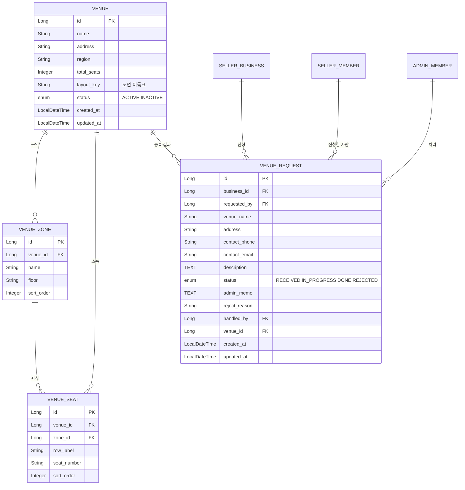

# 2부. 공연장 영역 (공연장 · 구역 · 좌석 · 공연장 신청)

> 이 부에서 다루는 테이블은 **4개**입니다.
> `venue`, `venue_zone`, `venue_seat`, `venue_request`
>
> 읽고 나면 알게 되는 것
> - 공연장 → 구역 → 좌석이 왜 3단계인지
> - 좌석 수천 개를 어떻게 만드는지 (좌석 생성 스크립트)
> - 프론트가 좌석도를 어떻게 그리는지

**컬럼 표 읽는 법**: 열쇠 아이콘은 키입니다. 금색 = **PK**(이 테이블의 고유 번호), 분홍색 = **FK**(다른 테이블의 번호를 가리키는 컬럼). 타입은 자바 기준이고, NULL은 "비워 둬도 되는지"입니다. 테이블 그림은 이미지(`p2-*.png`)로도 있습니다.

---

## 이 부의 ERD



---

## 2-1. 큰 그림: 공연장은 관리자가 만들고, 판매자가 고릅니다

```
관리자가 공연장 정보(JSON)를 넣는다 ─→ venue, venue_zone, venue_seat 가 만들어진다
판매자가 공연을 등록하면서 공연장을 고른다 ─→ performance.venue_id (3부)
판매 오픈 전날 venue_seat 를 복사해 판매 좌석을 만든다 ─→ schedule_seat (3부)
```

**Q. 왜 공연장 → 구역 → 좌석, 3단계인가요?**

- **공연장**은 건물입니다. (이름, 주소, 지역)
- **구역**은 층이나 블록입니다. (2층 26구역) 가격과 등급을 **구역 단위**로 정하고, 좌석 조회도 "구역 요약 → 구역 상세" 2단계로 하기 때문에 구역이 따로 필요합니다.
- **좌석**은 실제 자리입니다. (9열 6번)

**Q. 공연장마다 좌석 구조가 다른데, 공연장마다 테이블을 따로 만드나요?**

아닙니다. 달라지는 것은 **데이터**(구역이 몇 개, 열이 몇 개)이지 구조가 아닙니다. 테이블과 코드는 하나이고, 공연장이 늘어나면 행이 늘어납니다. 공연장 종류마다 클래스를 나눌 필요가 없습니다.

### venue (공연장)

**공연장** · `venue`

| 키 | 한글명 | 컬럼 | 타입 | NULL | 설명 |
|---|---|---|---|---|---|
| PK | 공연장 번호 | `id` | Long | NOT NULL |  |
|  | 공연장명 | `name` | String | NOT NULL |  |
|  | 주소 | `address` | String | NOT NULL |  |
|  | 지역 | `region` | String | NOT NULL | 서울, 경기 등. 지역별 공연 조회에 사용 |
|  | 총 좌석 수 | `total_seats` | Integer | NOT NULL | 좌석 생성 스크립트가 세어서 자동 입력 |
|  | 도면 키 | `layout_key` | String | NULL | 프론트가 쓸 도면 이름표. 비어 있으면 기본 격자 도면 |
|  | 상태 | `status` | enum | NOT NULL | ACTIVE 사용 중 / INACTIVE 사용 중지 |
|  | 생성일 | `created_at` | LocalDateTime | NOT NULL |  |
|  | 수정일 | `updated_at` | LocalDateTime | NOT NULL |  |

**Q. `layout_key`는 뭔가요?**

프론트가 **어떤 도면을 그릴지 고르는 이름표**입니다. 예를 들어 `"sample-arena"`이면 프론트에 만들어 둔 전용 도면을 쓰고, **비어 있으면 기본 격자 도면**(구역 → 열 → 번호 순)으로 그립니다. DB의 id는 환경마다 달라질 수 있어서 id 대신 이 이름표를 씁니다.

**Q. 공연장을 지울 수 있나요?**

지우지 않고 `status`를 사용 중지로 바꿉니다. 이미 공연이 잡힌 공연장일 수 있기 때문입니다. 사용 중지된 공연장은 판매자의 공연장 선택 목록에서 빠집니다.

**Q. `total_seats`는 직접 입력하나요?**

아닙니다. 좌석 생성 스크립트가 만든 좌석 수를 세서 자동으로 넣습니다.

---

## 2-2. 구역과 좌석

### venue_zone (공연장 구역)

**공연장 구역** · `venue_zone`

| 키 | 한글명 | 컬럼 | 타입 | NULL | 설명 |
|---|---|---|---|---|---|
| PK | 구역 번호 | `id` | Long | NOT NULL |  |
| FK | 공연장 번호 | `venue_id` | Long | NOT NULL | 어느 공연장의 구역인지 (venue) |
|  | 구역명 | `name` | String | NOT NULL | 예: F2구역, 스탠딩 A |
|  | 층 | `floor` | String | NULL | 예: 1층, 2층. 단층이거나 스탠딩이면 비움 |
|  | 정렬 순서 | `sort_order` | Integer | NOT NULL | 화면에 보여줄 순서 |

### venue_seat (공연장 좌석 원본)

**공연장 좌석** · `venue_seat`

| 키 | 한글명 | 컬럼 | 타입 | NULL | 설명 |
|---|---|---|---|---|---|
| PK | 좌석 번호 | `id` | Long | NOT NULL |  |
| FK | 공연장 번호 | `venue_id` | Long | NOT NULL | 어느 공연장의 좌석인지 (venue) |
| FK | 구역 번호 | `zone_id` | Long | NOT NULL | 어느 구역의 좌석인지 (venue_zone) |
|  | 열 | `row_label` | String | NOT NULL | 예: 9열, 스탠딩 |
|  | 좌석 번호 | `seat_number` | String | NOT NULL | 예: 6, BALCONY-1 (문자도 가능) |
|  | 정렬 순서 | `sort_order` | Integer | NOT NULL | 구역 안에서 열 → 번호 순으로 매긴 표시 순서 |

**Q. 열과 좌석 번호가 왜 숫자가 아니라 문자열인가요?**

"9열", "BALCONY-1", "스탠딩"처럼 숫자가 아닌 값이 있기 때문입니다. 대신 문자열은 정렬하면 "10"이 "2"보다 앞에 오기 때문에, **표시 순서를 따로 `sort_order`로 저장**합니다. 생성 스크립트가 구역 안에서 열 → 번호 순서대로 번호를 매깁니다.

**Q. 스탠딩 구역은 어떻게 하나요?**

구역과 좌석으로 똑같이 처리합니다. 예를 들어 구역 "Floor석", 열 "스탠딩", 번호 1~500으로 만듭니다. 별도 재고 테이블이 필요 없어서 구조가 단순해집니다. 행 수는 늘어나지만 구현은 쉬워집니다.

**Q. 도면에서 한 구역 안에 색(등급)이 갈리면 어떻게 하나요?**

**등급은 구역 단위로 정하기 때문에, 한 구역은 한 등급이어야 합니다.** 도면에서 한 구역 안의 색이 갈리면 구역을 둘로 나눕니다. 이 도면의 하단 중앙 블록이 그런 경우라서 `C2-1구역`(번호 1~9), `C2-2구역`(번호 10~18)으로 나눴습니다.

**Q. 좌석 데이터를 나중에 고칠 수 있나요?**

> ⚠️ **공연이 한 번이라도 잡힌 공연장의 좌석 행은 수정하거나 삭제하지 않습니다.** 회차별 판매 좌석(`schedule_seat`)이 이 행을 가리키고 있기 때문입니다. 구조를 바꿔야 하면 공연장을 새로 만드는 쪽이 안전합니다.

`(구역, 열, 번호)` 조합은 중복될 수 없습니다.

---

## 2-3. 좌석 생성 스크립트

**Q. 왜 필요한가요?**

공연장은 좌석이 수천 개입니다. `venue_seat`에 손으로 입력할 수 없어서, **구조를 적은 설명서(JSON)를 주면 구역과 좌석을 자동으로 만들어 주는 프로그램**이 필요합니다.

### 입력 형식 (JSON)

```json
{
  "name": "가상 아레나 (샘플)",
  "address": "서울 (가상)",
  "region": "서울",
  "layoutKey": "sample-arena",
  "zones": [
    { "name": "F2구역", "floor": "1층",
      "rows": [ { "rowRange": [1, 11], "suffix": "열", "from": 1, "to": 20 } ] },
    { "name": "C1구역", "floor": "2층",
      "rows": [
        { "rowRange": [1, 5],  "suffix": "열", "from": 12, "to": 20 },
        { "rowRange": [6, 12], "suffix": "열", "from": 5,  "to": 20 }
      ] },
    { "name": "G구역", "floor": "2층",
      "rows": [ { "label": "1열", "from": 1, "to": 2 }, { "label": "2열", "from": 1, "to": 4 } ] },
    { "name": "Floor석", "floor": "1층",
      "rows": [ { "label": "스탠딩", "from": 1, "to": 500 } ] }
  ]
}
```

| 항목 | 설명 |
|---|---|
| `zones` | 구역 목록. **적은 순서대로** 화면에 보이는 순서(`sort_order`)가 됩니다 |
| `rows` 한 줄 (`label`, `from`, `to`) | 열 하나. 예: "1열", 번호 1~4 |
| `rows` 묶음 (`rowRange`, `suffix`, `from`, `to`) | 같은 모양의 열을 한 번에. 위 `F2구역`은 1열~11열이 모두 번호 1~20 |
| `from`, `to` | 시작·끝 번호. 시작이 1이 아니어도 됩니다 (C1구역은 5번부터) |
| `memo` | 사람이 보는 메모. 프로그램은 무시합니다 |
| 문자 번호 | 번호가 문자인 열은 `"numbers": ["BALCONY-1", "BALCONY-2"]`처럼 직접 적습니다 |

### 프로그램이 하는 일

1. 공연장 한 줄을 `venue`에 저장합니다.
2. 구역을 순서대로 `venue_zone`에 저장합니다. (`sort_order` 1, 2, 3 ...)
3. 각 구역의 열과 번호를 돌면서 `venue_seat`를 만듭니다. (`sort_order`는 구역 안에서 차례대로)
4. 만든 좌석 수를 세서 `venue.total_seats`에 넣습니다.
5. 이 모든 과정을 **한 트랜잭션**으로 묶습니다. 중간에 하나라도 실패하면 전부 되돌립니다.

### 실행하는 방법

| 방법 | 설명 |
|---|---|
| ① 앱 시작 시 자동 | 프로젝트의 `venue-seed-*.json`을 읽어 **처음 한 번** 생성 (이미 같은 이름의 공연장이 있으면 건너뜀). 팀원 모두 같은 데이터로 시작 |
| ② 관리자 API | `POST /admin/venues`로 같은 JSON을 보내 생성. 관리자 화면 없이 Swagger나 Postman으로 가능 |

생성 로직은 하나(`VenueGenerator`)만 만들고, ①과 ②가 같은 로직을 호출합니다.

---

## 2-4. 공연장 신청: `venue_request`

**Q. 이건 언제 쓰나요?**

판매자가 공연장 목록에서 원하는 공연장을 못 찾을 때 신청하는 테이블입니다. 공연장 데이터는 좌석 배치도를 받아서 사람이 정리해야 하므로, **소통은 사이트 밖(메일, 전화)에서 하고 사이트에는 신청 기록과 상태만 남깁니다.** 그래서 기능은 최소입니다.

**공연장 신청** · `venue_request`

| 키 | 한글명 | 컬럼 | 타입 | NULL | 설명 |
|---|---|---|---|---|---|
| PK | 신청 번호 | `id` | Long | NOT NULL |  |
| FK | 사업체 번호 | `business_id` | Long | NOT NULL | 신청한 회사 (seller_business) |
| FK | 신청한 사람 | `requested_by` | Long | NOT NULL | 신청한 판매자 계정 (seller_member) |
|  | 공연장명 | `venue_name` | String | NOT NULL | 신청한 공연장 이름 |
|  | 주소 | `address` | String | NULL | 선택 입력 |
|  | 연락처 | `contact_phone` | String | NOT NULL | 운영팀이 연락할 전화번호 |
|  | 연락 이메일 | `contact_email` | String | NOT NULL | 좌석 배치도를 받을 이메일 |
|  | 설명 | `description` | TEXT | NULL | 신청자의 추가 설명 |
|  | 상태 | `status` | enum | NOT NULL | RECEIVED 접수됨 / IN_PROGRESS 처리 중 / DONE 등록 완료 / REJECTED 등록 불가 |
|  | 처리 메모 | `admin_memo` | TEXT | NULL | 사이트 밖 소통 내용(메일·전화)을 남김 |
|  | 불가 사유 | `reject_reason` | String | NULL | 등록 불가일 때만 값이 있음 |
| FK | 처리한 관리자 | `handled_by` | Long | NULL | 처리한 관리자 (admin_member) |
| FK | 등록된 공연장 | `venue_id` | Long | NULL | 등록 완료 후 만들어진 공연장 (venue). 완료 전에는 비어 있음 |
|  | 생성일 | `created_at` | LocalDateTime | NOT NULL |  |
|  | 수정일 | `updated_at` | LocalDateTime | NOT NULL |  |

**흐름**

1. 판매자가 공연장 이름, 연락처(전화, 이메일), 설명을 적어 신청합니다. → 상태 `RECEIVED`(접수됨)
2. 관리자가 신청을 확인하고 **처리 중**(`IN_PROGRESS`)으로 바꾼 뒤, 연락처로 메일·전화해서 좌석 배치도를 받습니다. 소통 내용은 `admin_memo`에 남깁니다.
3. 받은 배치도를 JSON으로 정리해 **관리자 API(`POST /admin/venues`)**로 공연장을 만듭니다.
4. 신청에 만들어진 공연장(`venue_id`)을 연결하고 **등록 완료**(`DONE`)로 바꿉니다.
5. 중복이거나 연락이 안 되면 **등록 불가**(`REJECTED`)와 사유를 남깁니다.

---

## 2-5. 프론트는 좌석도를 어떻게 그리나

백엔드는 **"좌석 명단"만** 주고, 프론트가 **"도면"**에 맞춰 그립니다. 좌표를 백엔드에서 관리하지 않습니다.

```json
// 1단계: 구역 요약 (구역별 잔여석)
[
  { "zoneId": 12, "name": "F2구역", "floor": "1층", "grade": "R석", "price": 154000, "remaining": 38, "total": 220 }
]

// 2단계: 구역을 눌렀을 때 좌석 상태
[
  { "seatId": 9301, "row": "9열", "number": "6", "status": "AVAILABLE" },
  { "seatId": 9302, "row": "9열", "number": "7", "status": "HELD" }
]
```

- 프론트는 "F2구역 → 9열 → 6번"이라는 **이름**으로 자기 도면의 자리를 찾고, 상태에 따라 색을 칠합니다. 클릭하면 `seatId`를 보내 점유를 요청합니다.
- 어떤 도면을 쓸지는 공연장의 `layout_key`로 정하고, **비어 있으면 기본 격자 도면**으로 그립니다. 그래서 관리자가 새 공연장을 만들어도 화면이 깨지지 않습니다.
- 백엔드는 좌석 번호만이 아니라 **변하지 않는 좌석 ID, 구역별 묶음, 표시 순서(`sort_order`), 상태·등급·가격**을 함께 보내야 합니다.

---

## 2-6. 이 영역의 기능과 테이블 연결

| 기능 | 쓰는 테이블 | 핵심 동작 |
|---|---|---|
| 공연장 목록·검색 (예매자·판매자) | `venue` | 지역·이름으로 검색, 사용 중인 공연장만 |
| 공연장 상세·구역 조회 | `venue`, `venue_zone` | 구역을 `sort_order` 순으로 |
| 판매자의 공연장 선택 | `venue` | 공연 등록 때 선택, `venue_id`가 공연에 저장됨 |
| 관리자의 공연장 생성 | `venue`, `venue_zone`, `venue_seat` | JSON → 한 트랜잭션으로 생성, `total_seats` 계산 |
| 공연장 신청 | `venue_request` | 접수 기록만 남김 (소통은 사이트 밖) |
| 신청 처리 | `venue_request`, `venue` | 상태 변경, 메모, 완료 시 만들어진 공연장 연결 |

---

## 부록 A. 샘플 공연장 초안

받은 좌석 배치도를 기준으로 만든 초안입니다. 파일은 `venue-seed-sample-arena.json`입니다.

**정한 내용**
- 공연장 이름은 **가상 이름**(`가상 아레나 (샘플)`)으로 했습니다. 구조만 참고했습니다.
- 중앙 Floor석은 좌석 번호가 없는 스탠딩 성격이라 **500석**으로 가정했습니다.
- 휠체어석 표시는 **이번에는 제외**했습니다. (확장)
- 하단 구역은 도면에 이름이 없어서 **C1 ~ C3** 임시 이름을 붙였습니다. 하단 중앙은 색이 갈려 `C2-1`, `C2-2`로 나눴습니다.
- 하단 양끝의 사선 쐐기 구역은 이번 초안에서 **제외**했습니다.
- 가장자리 계단형 구역과 대각선 구역은 **직사각형으로 근사**했습니다.

**구역별 요약**

| 구역 | 층 | 열 수 | 좌석 수 | 믿을 수 있는 정도 | 메모 |
|---|---|---|---|---|---|
| Floor석 | 1층 | 1 | 500 | 가정 | 스탠딩 성격(좌석 번호 없음). 500석으로 가정 |
| F1구역 | 1층 | 11 | 66 | 높음 | 도면에서 확인 |
| F2구역 | 1층 | 11 | 220 | 높음 | 도면에서 확인 |
| F3구역 | 1층 | 11 | 66 | 높음 | 도면에서 확인 |
| A1구역 | 2층 | 9 | 86 | 중간 | 8·9열은 가장자리라 일부만 있음(추정) |
| A2구역 | 2층 | 10 | 120 | 중간 | 직사각형 |
| A3구역 | 2층 | 10 | 120 | 중간 | 직사각형 |
| A4구역 | 2층 | 9 | 115 | 중간 | 8·9열은 가장자리라 일부만 있음(추정) |
| G구역 | 2층 | 6 | 42 | 낮음 | 계단형 구역, 열마다 좌석 수가 다름(추정) |
| B1구역 | 2층 | 13 | 130 | 낮음 | 대각선 배치를 직사각형으로 근사 |
| B2구역 | 2층 | 9 | 207 | 낮음 | 대각선 배치를 직사각형으로 근사 |
| C1구역 | 2층 | 12 | 157 | 중간 | 하단 GATE 5쪽, 구역 이름 임시 |
| C2-1구역 | 2층 | 12 | 108 | 중간 | 하단 중앙 왼쪽(빨강), 이름 임시 |
| C2-2구역 | 2층 | 12 | 108 | 중간 | 하단 중앙 오른쪽(파랑), 이름 임시 |
| C3구역 | 2층 | 12 | 157 | 중간 | 하단 GATE 6쪽, 구역 이름 임시 |
| D1구역 | 2층 | 13 | 130 | 낮음 | B1의 좌우 대칭으로 근사 |
| D2구역 | 2층 | 9 | 207 | 낮음 | B2의 좌우 대칭으로 근사 |
| E1구역 | 2층 | 9 | 86 | 중간 | A1의 좌우 대칭으로 근사 |
| E2구역 | 2층 | 10 | 120 | 중간 | 직사각형 |
| E3구역 | 2층 | 10 | 120 | 중간 | 직사각형 |
| E4구역 | 2층 | 9 | 115 | 중간 | A4의 좌우 대칭으로 근사 |
| H구역 | 2층 | 6 | 42 | 낮음 | G의 좌우 대칭으로 근사 |
| **합계** | | | **3022** | | Floor석 500석 포함. 제외하면 2522석 |

**확인 부탁드리는 곳**: 믿을 수 있는 정도가 "낮음", "중간"인 구역은 도면과 비교해서 틀린 곳을 알려 주세요. 예: "A4구역 8열은 10석". 알려 주시면 JSON을 바로 고칩니다.

---

## 2부 요약

- 공연장은 **관리자가 만들고**, 판매자가 공연 등록 때 고른다. 구조는 **공연장 → 구역 → 좌석** 3단계다.
- 공연장마다 달라지는 것은 코드가 아니라 **데이터**다. 좌석은 JSON을 읽는 생성 스크립트로 한꺼번에 만든다.
- 열과 번호는 문자열이고, 표시 순서는 `sort_order`로 따로 저장한다. 스탠딩도 구역 + 번호로 똑같이 처리한다.
- 한 구역은 한 등급이다. 색이 갈리면 구역을 나눈다.
- 프론트는 좌석 명단을 받아 **자기 도면**에 그린다. 도면은 `layout_key`로 고르고, 없으면 기본 격자로 그린다.
- 공연장 신청은 테이블만 두고, 소통은 사이트 밖에서 한다.

다음은 **3부. 공연 영역** (`performance`, `performance_schedule`, `seat_grade`, `zone_grade`, `schedule_seat` 등)입니다.
