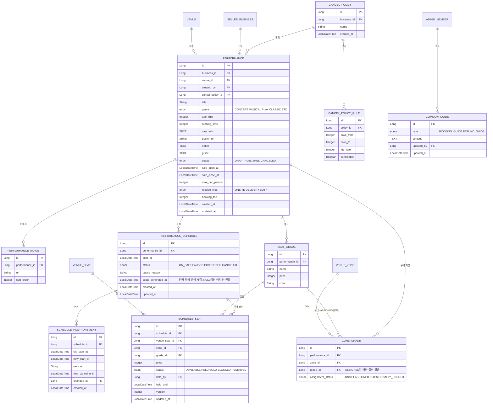

# 3부. 공연 영역 (공연 · 회차 · 등급 · 판매 좌석 · 취소 규정)

> 이 부에서 다루는 테이블은 **10개**입니다. 프로젝트에서 가장 중요한 테이블(`schedule_seat`)이 여기 있습니다.
> `performance`, `performance_image`, `performance_schedule`, `schedule_postponement`, `seat_grade`, `zone_grade`, `schedule_seat`, `cancel_policy`, `cancel_policy_rule`, `common_guide`
>
> 읽고 나면 알게 되는 것
> - 공연 하나가 어떻게 회차, 등급, 판매 좌석으로 펼쳐지는지
> - 판매 상태를 왜 회차에 두는지, 연기가 생기면 어떤 테이블이 바뀌는지
> - 공연 상세 화면이 어떤 테이블을 조합해서 만들어지는지

**컬럼 표 읽는 법**: 열쇠 아이콘은 키입니다. 금색 = **PK**, 분홍색 = **FK**. 타입은 자바 기준이고, NULL은 "비워 둬도 되는지"입니다. 테이블 그림은 이미지(`p3-*.png`)로도 있습니다.

---

## 이 부의 ERD



---

## 3-1. 큰 그림: 공연 하나가 판매 좌석 수천 개로 펼쳐집니다

```
판매자가 공연을 등록한다 ──────────→ performance (+ performance_image)
  └ 등급과 가격을 만든다 ───────────→ seat_grade   (R석 154,000원 ...)
  └ 구역마다 설정 상태와 등급을 정한다 → zone_grade (F2구역 = R석, 의도적 미판매 ...)
  └ 회차를 추가한다 ────────────────→ performance_schedule (11/1 19:00)
       └ 판매 오픈 전날, 공연장 좌석을 복사한다 ─→ schedule_seat (회차 × 좌석 수만큼 행 생성)
```

**Q. 왜 좌석을 회차마다 복사하나요?**

공연장 좌석(`venue_seat`)은 "이 건물에 이런 자리가 있다"는 **원본**입니다. 그런데 팔리는 것은 "11/1 공연의 F2구역 9열 6번"입니다. 같은 자리라도 회차마다 팔렸는지, 가격이 얼마인지가 다릅니다. 그래서 회차마다 원본을 복사해서 **그 회차 전용 판매 좌석**을 만듭니다. (복사하는 시점은 판매 오픈 전날입니다. 3-5 참고) 샘플 공연장(3,022석)이라면 회차 하나에 약 3천 행이 생깁니다.

**Q. 행이 너무 많지 않나요?**

회차 10개면 3만 행입니다. DB에게는 작은 양이고, 대신 "좌석 하나를 잠그고 상태를 바꾼다"가 **행 하나만 다루는 단순한 일**이 되어서 동시성 처리가 쉬워집니다.

---

## 3-2. 공연: `performance`

### performance (공연)

**공연** · `performance`

| 키 | 한글명 | 컬럼 | 타입 | NULL | 설명 |
|---|---|---|---|---|---|
| PK | 공연 번호 | `id` | Long | NOT NULL |  |
| FK | 사업체 번호 | `business_id` | Long | NOT NULL | 공연을 올린 회사 (seller_business) |
| FK | 공연장 번호 | `venue_id` | Long | NOT NULL | 공연이 열리는 공연장 (venue) |
| FK | 등록한 사람 | `created_by` | Long | NOT NULL | 등록한 판매자 계정 (seller_member) |
| FK | 취소 규정 번호 | `cancel_policy_id` | Long | NOT NULL | 적용할 취소 규정 (cancel_policy) |
|  | 공연명 | `title` | String | NOT NULL |  |
|  | 장르 | `genre` | enum | NOT NULL | 콘서트 / 뮤지컬 / 연극 / 클래식 / 기타 |
|  | 관람 연령 | `age_limit` | Integer | NOT NULL | 만 N세 이상. 전체 관람가는 0 |
|  | 러닝타임(분) | `running_time` | Integer | NOT NULL | 회차 시간 겹침 검사에 사용 |
|  | 출연진 | `cast_info` | TEXT | NULL |  |
|  | 포스터 | `poster_url` | String | NOT NULL |  |
|  | 판매자 공지 | `notice` | TEXT | NULL | 이 공연만의 공지 |
|  | 이용 안내 | `guide` | TEXT | NULL | 이 공연만의 안내 |
|  | 상태 | `status` | enum | NOT NULL | DRAFT 작성 중 / PUBLISHED 공개 / CANCELED 공연 취소 |
|  | 판매 오픈 일시 | `sale_open_at` | LocalDateTime | NULL | DRAFT에서는 미설정 가능. PUBLISHED 전 설정 필수. 모든 회차 공통 |
|  | 판매 종료 일시 | `sale_close_at` | LocalDateTime | NULL | DRAFT에서는 미설정 가능. PUBLISHED 전 설정 필수. 모든 회차 공통 |
|  | 1인 최대 매수 | `max_per_person` | Integer | NULL | DRAFT에서는 미설정 가능. PUBLISHED 전 설정 필수 |
|  | 수령 방법 | `receive_type` | enum | NULL | DRAFT에서는 미설정 가능. PUBLISHED 전 설정 필수. ONSITE 현장 / DELIVERY 배송 / BOTH 예매자 선택 |
|  | 예매 수수료 | `booking_fee` | Integer | NULL | DRAFT에서는 미설정 가능. PUBLISHED 전 설정 필수. 티켓 1장당 원. 판매자가 공연마다 설정 |
|  | 생성일 | `created_at` | LocalDateTime | NOT NULL |  |
|  | 수정일 | `updated_at` | LocalDateTime | NOT NULL |  |

판매 오픈·종료 시각, 1인 최대 매수, 수령 방법, 예매 수수료는 `performance`의 일반 필드입니다. 공연 등록·수정 요청에서 함께 관리하며, DRAFT에서는 비워 둘 수 있고 PUBLISHED 전환 시 모두 설정되어 있는지 확인합니다. 별도 판매 정책 저장 API는 두지 않습니다.

**Q. `status`는 왜 3개뿐인가요?**

판매 상태는 **회차**에 두기 때문입니다. 공연에는 "작성 중 / 공개 / 취소"만 있습니다.

| 값 | 의미 |
|---|---|
| `DRAFT` | 판매자가 작성 중. 예매자에게 안 보임 |
| `PUBLISHED` | 공개됨. 예매자 목록에 보임 |
| `CANCELED` | 공연 전체 취소 |

"판매 예정 / 판매 중 / 판매 종료 / 매진"은 **저장하지 않고 계산**합니다. 판매 오픈 시각 전이면 예정, 공연 시각이 지났으면 종료, 남은 좌석이 0이면 매진입니다. 저장하는 상태가 적을수록 값이 서로 안 맞는 버그가 줄어듭니다.

**Q. 판매 시작일과 1인 최대 매수는 왜 공연에 있고 회차에는 없나요?**

보통 한 공연의 모든 회차가 같은 시각에 오픈하고, 인당 매수도 같기 때문입니다. 회차마다 다르게 할 일이 생기면 그때 확장합니다.

**1인 최대 매수 규칙** (검사 방법은 4부 4-7)
- **공연의 모든 회차를 합친 누적** 기준입니다. 11/1 회차에서 2장, 11/2 회차에서 2장을 사면 합계 4장입니다.
- 취소하거나 만료된 좌석은 빼고 셉니다. (취소하면 그만큼 다시 살 수 있음. 정책은 임시)
- 예매가 한 건이라도 생긴 뒤에는 **값을 늘리는 것만** 가능하고 줄일 수는 없습니다. 줄이면 이미 한도를 넘긴 사람이 생기기 때문입니다.

### 공연장 변경 시점

공연장은 `DRAFT`일 때만 변경할 수 있고, `PUBLISHED` 이후에는 바꿀 수 없습니다. 공연장을 바꾸면 새 공연장 기준으로 모든 회차의 시간 충돌을 다시 확인합니다. 공연 단위 등급(`seat_grade`)은 유지하지만, 기존 구역별 등급 설정은 새 공연장에 적용할 수 없으므로 새 공연장의 모든 구역을 `UNSET`으로 초기화하고 다시 설정합니다.

새 공연을 등록할 때도 공연장에 속한 모든 구역에 `UNSET` 행을 만듭니다. V8 마이그레이션은 기존 등급 연결을 `ASSIGNED`로 유지하고, 기존 DRAFT의 미등록 구역은 `UNSET`, 기존 공개·취소 공연의 미등록 구역은 과거 정책에 따라 `INTENTIONALLY_UNSOLD`로 변환합니다.

판매 좌석이 이미 생성된 회차가 있으면 예매·점유·판매자 보류 좌석이 없는 경우에만 기존 좌석을 삭제하고 `seats_generated_at`을 비워 재생성할 수 있습니다. 예매나 사용 중인 좌석이 있으면 공연장 변경을 거부합니다. 이 초기화는 `DRAFT` 공연장 변경에 한하며, 끝난 회차 좌석 정리 규칙과는 별개입니다.

**Q. 예매 수수료는 어떻게 하나요?**

**공연마다 판매자가 정합니다**(`booking_fee`, 티켓 1장당 원). 반대로 **대기열과 캡챠는 서비스 고정**이라 컬럼을 두지 않고 설정 파일의 값으로 처리합니다. (확장: 관리자 화면에서 정책 변경)

**Q. `receive_type`은 뭔가요?**

티켓을 받는 방법입니다. `ONSITE`(현장 수령), `DELIVERY`(배송), `BOTH`(예매자가 선택). 판매자가 공연마다 하나를 고릅니다.

**Q. `genre`는 어떤 값이 있나요?**

`콘서트`, `뮤지컬`, `연극`, `클래식`, `기타` 다섯 가지입니다. 늘어나면 값만 추가합니다.

### performance_image (공연 이미지)

**공연 이미지** · `performance_image`

| 키 | 한글명 | 컬럼 | 타입 | NULL | 설명 |
|---|---|---|---|---|---|
| PK | 이미지 번호 | `id` | Long | NOT NULL |  |
| FK | 공연 번호 | `performance_id` | Long | NOT NULL | 어느 공연의 이미지인지 (performance) |
|  | 이미지 주소 | `url` | String | NOT NULL |  |
|  | 정렬 순서 | `sort_order` | Integer | NOT NULL | 보여줄 순서 |

포스터는 `performance.poster_url`, 상세 설명용 이미지는 이 테이블에 여러 장 둡니다. `sort_order`가 보여줄 순서입니다.

---

## 3-3. 회차와 연기: `performance_schedule`, `schedule_postponement`

### performance_schedule (공연 회차)

**공연 회차** · `performance_schedule`

| 키 | 한글명 | 컬럼 | 타입 | NULL | 설명 |
|---|---|---|---|---|---|
| PK | 회차 번호 | `id` | Long | NOT NULL |  |
| FK | 공연 번호 | `performance_id` | Long | NOT NULL | 어느 공연의 회차인지 (performance) |
|  | 공연 일시 | `start_at` | LocalDateTime | NOT NULL |  |
|  | 판매 상태 | `status` | enum | NOT NULL | ON_SALE 판매 중 / PAUSED 일시중지 / POSTPONED 연기 / CANCELED 회차 취소 |
|  | 중지 사유 | `pause_reason` | String | NULL | 일시중지일 때만 |
|  | 좌석 생성 일시 | `seats_generated_at` | LocalDateTime | NULL | 판매 좌석(`schedule_seat`)을 만든 시각. 비어 있으면 아직 안 만든 회차 (3-5) |
|  | 생성일 | `created_at` | LocalDateTime | NOT NULL |  |
|  | 수정일 | `updated_at` | LocalDateTime | NOT NULL |  |

**Q. 판매 상태를 왜 회차에 두나요?**

한 공연에 회차가 3개 있고, 회차2만 연기해야 하는 경우를 생각해 보세요.

```
공연: 가상 콘서트
 ├ 회차1  11/1 19:00
 ├ 회차2  11/2 19:00   ← 출연자 사정으로 이 회차만 연기
 └ 회차3  11/3 19:00
```

- 상태가 공연에만 있으면 "연기"를 표시할 곳이 없고, 공연 전체를 바꾸면 멀쩡한 회차1·3까지 막힙니다.
- 상태가 회차에 있으면 회차2만 `POSTPONED`로 바꾸면 됩니다.

| 값 | 의미 |
|---|---|
| `ON_SALE` | 판매 중 (오픈 전·종료·매진은 계산해서 표시) |
| `PAUSED` | 판매자가 일시중지 |
| `POSTPONED` | 연기 |
| `CANCELED` | 이 회차 취소 |

- 목록의 "판매 중" 필터는 회차 중 하나라도 `ON_SALE`이면 판매 중으로 봅니다.
- 판매자가 **공연 단위로 일시중지**하면 서버가 그 공연의 모든 회차를 한꺼번에 `PAUSED`로 바꿉니다.

**Q. 같은 공연장에 시간이 겹치는 회차를 만들 수 있나요?**

안 됩니다. 회차를 만들 때 같은 공연장의 기존 회차와 시간이 겹치는지 검사하고, 겹치면 거절합니다. (겹침 기준은 `start_at` ~ `start_at + running_time`)

### schedule_postponement (회차 연기 이력)

**회차 연기 이력** · `schedule_postponement`

| 키 | 한글명 | 컬럼 | 타입 | NULL | 설명 |
|---|---|---|---|---|---|
| PK | 연기 번호 | `id` | Long | NOT NULL |  |
| FK | 회차 번호 | `schedule_id` | Long | NOT NULL | 연기된 회차 (performance_schedule) |
|  | 원래 일시 | `old_start_at` | LocalDateTime | NOT NULL |  |
|  | 새 일시 | `new_start_at` | LocalDateTime | NULL | 비어 있으면 새 일정 미정 |
|  | 사유 | `reason` | String | NOT NULL |  |
|  | 무료 취소 마감 | `free_cancel_until` | LocalDateTime | NOT NULL | 이 시각까지 수수료 없이 취소 가능 |
| FK | 처리한 사람 | `changed_by` | Long | NOT NULL | 연기를 처리한 판매자 (seller_member) |
|  | 생성일 | `created_at` | LocalDateTime | NOT NULL |  |

- `new_start_at`이 **비어 있으면 "새 일정 미정"**입니다. 새 일정이 정해지면 값을 채웁니다.
- `free_cancel_until`은 **무료 취소 마감일**입니다. 판매자가 입력하고, 기본값은 연기일 + 14일입니다.
- 이력 테이블이라 회차 하나에 연기가 여러 번 쌓일 수 있습니다.

### 연기가 생기면 어떤 테이블이 바뀌나요?

회차2(예매 120건)를 "새 일정 미정"으로 연기하는 경우입니다.

**① 판매자가 연기 처리하는 순간**

| 테이블 | 변화 |
|---|---|
| `performance_schedule` | **수정 1행**: 회차2의 `status`가 `ON_SALE` → `POSTPONED` |
| `schedule_postponement` | **추가 1행**: 원래 일시, 새 일시(`NULL`), 사유, 무료 취소 마감일, 처리한 판매자 |
| `audit_log` | **추가 1행**: 누가 무엇을 `ON_SALE` → `POSTPONED`로 바꿨는지 |

바뀌지 않는 것: 공연(`performance`), 회차1·3, 이미 팔린 좌석(`SOLD` 유지), 예매·결제. 예매 120건을 한꺼번에 UPDATE하지 않습니다. 사용자 화면은 회차 상태를 조인해서 "연기됨"으로 보여줍니다.

**② 사용자가 무료 취소를 누르면 (사용자 한 명당)**

| 테이블 | 변화 |
|---|---|
| `booking` | 상태 `CANCELED`, 사유 "공연 연기" |
| `schedule_seat` | 해당 좌석 `SOLD` → `AVAILABLE` (회차가 연기 상태라 판매는 재개되지 않음) |
| `refund` | 환불 1행 추가, **취소 수수료 0%** |
| `payment` | 환불 완료 시 상태 갱신 |

> **무료 취소(수수료 0%) 대상인지 판단하는 규칙** (두 조건을 모두 만족해야 합니다)
> 1. 그 회차의 **가장 최근 연기 이력**의 `free_cancel_until`이 아직 지나지 않았다.
> 2. 예매 생성 시각(`booking.created_at`)이 그 연기 이력의 `created_at`**보다 이전**이다. (연기를 알고 새로 예매한 건은 대상이 아님)
>
> 연기가 여러 번 쌓이면 **최신 이력만** 봅니다. 새 일정을 확정해 `ON_SALE`로 돌아온 뒤에도 마감 전이면 무료입니다. 이 판단은 취소 수수료 계산 코드 **한 곳**(예: `CancelFeeCalculator`)에서만 하고, 케이스별 테스트로 막아 둡니다.

**③ 새 일정이 확정되면**

| 테이블 | 변화 |
|---|---|
| `schedule_postponement` | `new_start_at`을 채움 |
| `performance_schedule` | `start_at`을 새 일시로 바꾸고 `status`를 `ON_SALE`로 복귀 |

취소하지 않은 예매는 그대로 새 일정으로 이어집니다.

---

## 3-4. 등급과 가격: `seat_grade`, `zone_grade`

판매자는 두 단계로 가격을 정합니다. **① 등급과 가격을 만들고, ② 구역마다 등급을 지정합니다.**

### seat_grade (좌석 등급)

**좌석 등급** · `seat_grade`

| 키 | 한글명 | 컬럼 | 타입 | NULL | 설명 |
|---|---|---|---|---|---|
| PK | 등급 번호 | `id` | Long | NOT NULL |  |
| FK | 공연 번호 | `performance_id` | Long | NOT NULL | 이 공연의 등급 (performance) |
|  | 등급명 | `name` | String | NOT NULL | 예: VIP석, R석, S석 |
|  | 가격 | `price` | Integer | NOT NULL | 등급마다 가격 1개 |
|  | 표시 색 | `color` | String | NULL | 좌석도에 칠할 색 (예: #E8503A) |

### zone_grade (구역별 등급)

**구역별 등급** · `zone_grade`

| 키 | 한글명 | 컬럼 | 타입 | NULL | 설명 |
|---|---|---|---|---|---|
| PK | 번호 | `id` | Long | NOT NULL |  |
| FK | 공연 번호 | `performance_id` | Long | NOT NULL | (performance) |
| FK | 구역 번호 | `zone_id` | Long | NOT NULL | 등급을 지정할 구역 (venue_zone) |
| FK | 등급 번호 | `grade_id` | Long | NULL | `ASSIGNED`일 때 지정한 등급 (seat_grade) |
|  | 설정 상태 | `assignment_status` | enum | NOT NULL | `UNSET` / `ASSIGNED` / `INTENTIONALLY_UNSOLD` |

**Q. 가격 종류(일반/청소년 등)는 없나요?**

없습니다. **등급마다 가격 1개**입니다. 필요해지면 확장합니다.

**Q. 왜 등급을 공연 단위로 만드나요?**

같은 공연장이라도 공연마다 가격 체계가 다르기 때문입니다. `zone_grade`는 "이 공연에서 이 구역을 어떻게 설정했는가"를 저장합니다. 공연장의 모든 구역마다 행을 하나씩 두고, 한 공연에서 한 구역은 한 번만 저장합니다.

**Q. 등급을 지정하지 않은 구역은요?**

세 상태를 구분합니다.

| 상태 | 의미 | `grade_id` | 공개 가능 |
|---|---|---|---|
| `UNSET` | 아직 판매자가 설정하지 않음 | NULL | 불가 |
| `ASSIGNED` | 판매할 등급을 지정함 | 등급 번호 | 가능 |
| `INTENTIONALLY_UNSOLD` | 의도적으로 판매하지 않음 | NULL | 가능 |

구역 등급 API는 일부 구역씩 설정할 수 있습니다. 요청에 포함되지 않은 구역의 상태는 그대로 둡니다. 공연 공개 시 `UNSET`이 남아 있으면 막고, `INTENTIONALLY_UNSOLD` 구역은 허용합니다. 의도적 미판매 구역의 좌석은 판매 좌석 생성 시 `BLOCKED`가 됩니다.

### 샘플 공연장 예시

2부의 샘플 공연장으로 가격을 정하면 이렇게 됩니다. (등급명과 금액은 임의의 예시입니다)

| 등급 | 가격 | 지정한 구역 | 좌석 수 |
|---|---|---|---|
| VIP석 | 165,000원 | Floor석(스탠딩) | 500 |
| R석 | 154,000원 | F1, F2, F3, C2-1, C2-2 | 568 |
| S석 | 132,000원 | A1~A4, E1~E4, C1, C3 | 1,196 |
| A석 | 99,000원 | B1, B2, D1, D2, G, H | 758 |
| **합계** | | | **3,022** |

회차 하나의 판매 좌석을 만들면 `schedule_seat`가 위 합계(3,022행)만큼 생깁니다.

---

## 3-5. 회차별 판매 좌석: `schedule_seat` ★

프로젝트의 핵심 테이블입니다. 동시성, 대기열, 매진 처리가 모두 이 테이블 위에서 일어납니다.

**회차별 판매 좌석** · `schedule_seat`

| 키 | 한글명 | 컬럼 | 타입 | NULL | 설명 |
|---|---|---|---|---|---|
| PK | 판매 좌석 번호 | `id` | Long | NOT NULL |  |
| FK | 회차 번호 | `schedule_id` | Long | NOT NULL | (performance_schedule) |
| FK | 공연장 좌석 번호 | `venue_seat_id` | Long | NOT NULL | 복사해 온 원본 좌석 (venue_seat) |
| FK | 구역 번호 | `zone_id` | Long | NOT NULL | 구역별 조회를 빠르게 하려고 복사 (venue_zone) |
| FK | 등급 번호 | `grade_id` | Long | NULL | 판매 제외 좌석은 비어 있음 (seat_grade) |
|  | 가격 | `price` | Integer | NULL | 등급 가격을 복사한 값. 판매 제외는 비어 있음 |
|  | 상태 | `status` | enum | NOT NULL | AVAILABLE / HELD 임시 점유 / SOLD / BLOCKED 판매 제외 / RESERVED 판매자 보류 |
| FK | 점유한 사용자 | `held_by` | Long | NULL | 임시 점유 중일 때만 (user_member) |
|  | 점유 만료 시각 | `held_until` | LocalDateTime | NULL | 임시 점유 중일 때만 |
|  | 버전 | `version` | Integer | NOT NULL | 낙관적 락 비교용 |
|  | 수정일 | `updated_at` | LocalDateTime | NOT NULL |  |

### 언제 만들어지나

**회차를 추가할 때는 `performance_schedule` 한 행만 만듭니다. 판매 좌석은 판매 오픈 전날에 만듭니다.** (`seats_generated_at`이 비어 있는 회차가 대상)

| 항목 | 방침 |
|---|---|
| 만드는 시점 | 판매 오픈 일시의 **24시간 전부터**. 스케줄러가 1시간마다 `seats_generated_at IS NULL`이고 오픈 24시간 전이 지난 회차를 찾아 만든다 (주기는 임시) |
| 오픈 당일에 만들지 않는 이유 | 오픈 직전은 서버가 가장 바쁜 때라, 수천 행을 만드는 작업이 겹치면 더 나쁘다. 실패해도 전날이면 고칠 시간이 있다 |
| 단위 | **회차 1개 = 트랜잭션 1개**. 장기 공연(회차 수십~수백 개)을 한꺼번에 등록해도 큰 트랜잭션이 생기지 않는다 |
| 이미 오픈 24시간 안인 공연에 회차를 추가 | 추가하는 즉시 만든다 |
| 앞당겨 만들기 | 판매자가 보류석을 미리 지정하고 싶으면 "좌석 지금 생성"을 눌러 실행할 수 있다 (같은 생성 코드) |
| 실패했을 때 | 그 회차만 롤백하고 다음 주기에 재시도한다. 같은 회차를 두 번 만들지 않게 `UNIQUE (schedule_id, venue_seat_id)`가 막고, `seats_generated_at`은 좌석 생성과 같은 트랜잭션에서 기록한다 |
| 나중에 좌석을 지운 회차 | `seats_generated_at`은 남아 있어서, 끝난 회차의 좌석을 정리해도 다시 만들지 않는다 |

**그래서 생기는 규칙**
- 가격은 **좌석을 만드는 시점**에 복사되므로, **좌석 생성 전까지는 등급·가격을 자유롭게 수정**하고 **생성 후에는 수정할 수 없습니다.**
- 판매자 보류석 지정(`RESERVED`)은 **좌석이 만들어진 뒤에만** 가능합니다. (일찍 하고 싶으면 앞당겨 만들기)
- 공연 공개와 판매 좌석 생성 전에 `UNSET` 구역이 없는지 확인합니다. `INTENTIONALLY_UNSOLD` 구역은 허용하고, 해당 좌석만 `BLOCKED`로 만듭니다.
- 좌석이 아직 없는 회차의 총 좌석 수는 `venue.total_seats`로 보여 줍니다.

### 어떻게 만들어지나

회차 하나의 좌석을 만들 때 **한 트랜잭션** 안에서 아래 한 문장(개념)으로 좌석이 복사됩니다.

```sql
INSERT INTO schedule_seat (schedule_id, venue_seat_id, zone_id, grade_id, price, status, version)
SELECT :scheduleId, vs.id, vs.zone_id,
       zg.grade_id,                                  -- 미판매 구역은 NULL
       g.price,                                      -- ASSIGNED 등급의 가격을 복사
       CASE WHEN zg.assignment_status = 'ASSIGNED' THEN 'AVAILABLE' ELSE 'BLOCKED' END,
       0
FROM venue_seat vs
JOIN zone_grade zg ON zg.zone_id = vs.zone_id AND zg.performance_id = :performanceId
LEFT JOIN seat_grade g ON g.id = zg.grade_id AND zg.assignment_status = 'ASSIGNED'
WHERE vs.venue_id = :venueId;
```

좌석 생성 전에 `UNSET`이 없어야 합니다. `ASSIGNED`는 `AVAILABLE`, `INTENTIONALLY_UNSOLD`는 `BLOCKED`로 생성합니다.

- **가격을 복사하는 이유**: 나중에 등급 가격이 바뀌어도 이미 만든 회차와 예매의 가격이 흔들리지 않게 하기 위해서입니다.
- `zone_id`를 함께 복사하는 이유: "F2구역의 잔여석 수" 같은 구역별 조회를 조인 없이 하기 위해서입니다.

### 좌석 상태

| 값 | 이름 | 의미 | 예매 가능 |
|---|---|---|---|
| `AVAILABLE` | 판매 가능 | 누구나 선택 가능 | O |
| `HELD` | 결제 중 임시 점유 | 한 사용자가 결제하는 중. `held_by`, `held_until`이 채워짐 | X |
| `SOLD` | 판매 완료 | 결제까지 끝남 | X |
| `BLOCKED` | 판매 제외 | 무대 설치·시야 방해로 없는 자리 또는 `INTENTIONALLY_UNSOLD` 구역. 등급·가격 없음 | X |
| `RESERVED` | 판매자 보류 | 초대권, 협찬, 관계자용으로 판매자가 따로 잡아 둔 자리. 나중에 풀어서 판매할 수 있음 | X |

> `HELD`(결제 중 임시 점유)와 `RESERVED`(판매자 보류)는 이름이 비슷해서 헷갈립니다. 팀에서는 **"임시 점유"**와 **"판매자 보류석"**으로 부르기를 권합니다.

```
            점유 요청                결제 완료
AVAILABLE ───────────→ HELD ───────────→ SOLD
    ↑                    │
    └── 시간 초과·취소 ──┘                (예매 취소·환불 시 SOLD → AVAILABLE)

AVAILABLE ⇄ RESERVED     (판매자가 보류했다가 푼다)
BLOCKED                  (바뀌지 않음)
```

**Q. 좌석 점유는 어떻게 동시에 눌러도 안 꼬이나요?**

좌석 행 하나를 `SELECT ... FOR UPDATE`로 잠그고 `AVAILABLE`일 때만 `HELD`로 바꿉니다. `version`은 낙관적 락 방식을 비교 실험할 때 쓰는 컬럼이고, 기본은 FOR UPDATE입니다. 상세 흐름은 4부(예매·결제)에서 다룹니다.

**Q. 점유가 풀리지 않고 남으면요?**

`held_until`이 지난 `HELD` 좌석을 스케줄러가 주기적으로 `AVAILABLE`로 되돌립니다. **상태의 기준은 DB**이고, Redis를 쓰더라도 만료 감지를 돕는 보조 수단입니다.

**Q. 등급·가격·회차 일시는 언제까지 바꿀 수 있나요?**

> ⚠️ **판매 좌석을 만든 뒤에는 등급과 가격을 수정할 수 없습니다.** 이미 복사된 좌석의 가격과 어긋나기 때문입니다. **예매가 한 건이라도 생긴 뒤에는 회차 일시도 수정할 수 없고**, 일시 변경은 "연기" 기능을 사용합니다.

**조회에 쓰는 인덱스(권장)**

| 용도 | 인덱스 |
|---|---|
| 구역 요약(잔여석), 구역 상세 | `(schedule_id, zone_id, status)` |
| 같은 회차에서 같은 좌석 중복 방지 | UNIQUE `(schedule_id, venue_seat_id)` |
| 만료된 점유 정리 | 부분 인덱스 `(held_until) WHERE status = 'HELD'` (점유 중인 좌석만 담겨서 작음) |

**테이블 설정(권장)**: 이 테이블은 상태가 자주 바뀌는 **UPDATE가 많은 테이블**입니다. PostgreSQL은 UPDATE할 때 옛 행을 지우지 않고 새 행을 만들어서, 그대로 두면 죽은 행과 인덱스가 쌓여 느려집니다. 그래서 행에 여유 공간을 두고, 이 테이블만 청소(autovacuum)를 더 자주 돌립니다. (수치는 부하 테스트로 조정합니다.)

```sql
ALTER TABLE schedule_seat SET (fillfactor = 80, autovacuum_vacuum_scale_factor = 0.02);
```

### 행이 너무 많아지지 않을까요? (규모와 정리)

샘플 공연장(3,022석) 기준으로 공연 100개, 회차 500개면 약 **150만 행**입니다. (좌석은 오픈 전날 만들기 때문에, 아직 오픈 전인 회차는 행이 없어서 실제로는 이보다 적습니다.) 행 하나가 작아서 인덱스를 포함해도 수백 MB 수준이고, PostgreSQL은 인덱스가 있으면 이 정도는 무리 없이 처리합니다. (실제 수치는 부하 테스트로 확인합니다.) 그래도 쌓이기만 하면 낭비라서 **끝난 회차의 좌석 행은 지웁니다.**

| 항목 | 방침 |
|---|---|
| 지우는 대상 | 끝난 회차의 `schedule_seat` (회차, 예매, 결제는 남김) |
| 지우는 시점 | 공연이 끝나고 **무료 취소·환불 처리 기간이 지난 뒤** (예: 공연 후 30일) |
| 지워도 되는 이유 | 누가 어떤 좌석을 얼마에 샀는지는 `booking_seat`에 **스냅샷**(구역명, 열, 번호, 등급명, 가격)으로 남아 있음 |
| 필요한 설계 | `booking_seat`가 `schedule_seat`를 가리키는 컬럼을 **NULL 허용**으로 둠 (4부) |
| 지우는 방법 | 스케줄러가 회차 단위로 묶어서 삭제 |
| 지우지 않는 경우 | 환불이 진행 중인 예매가 있는 회차 |
| 확장 | 파티셔닝(회차 기준), 보관용 테이블로 이동 |

> ⚠️ 이 방침은 **"예매 좌석에 스냅샷을 저장한다"**는 전제 위에서만 성립합니다. 4부에서 `booking_seat`를 그렇게 설계합니다.

---

## 3-6. 취소 규정: `cancel_policy`, `cancel_policy_rule`

### cancel_policy (취소 규정)

**취소 규정** · `cancel_policy`

| 키 | 한글명 | 컬럼 | 타입 | NULL | 설명 |
|---|---|---|---|---|---|
| PK | 규정 번호 | `id` | Long | NOT NULL |  |
| FK | 사업체 번호 | `business_id` | Long | NULL | 비어 있으면 서비스 기본 규정 (seller_business) |
|  | 규정명 | `name` | String | NOT NULL | 예: 기본 규정 |
|  | 생성일 | `created_at` | LocalDateTime | NOT NULL |  |

### cancel_policy_rule (취소 규정 구간)

**취소 규정 구간** · `cancel_policy_rule`

| 키 | 한글명 | 컬럼 | 타입 | NULL | 설명 |
|---|---|---|---|---|---|
| PK | 구간 번호 | `id` | Long | NOT NULL |  |
| FK | 규정 번호 | `policy_id` | Long | NOT NULL | (cancel_policy) |
|  | 시작(N일 전 이상) | `days_from` | Integer | NOT NULL | 공연 며칠 전부터 |
|  | 끝(N일 전 이하) | `days_to` | Integer | NULL | 비어 있으면 제한 없음 |
|  | 수수료율(%) | `fee_rate` | Integer | NOT NULL | 0~100 |
|  | 취소 가능 | `cancelable` | Boolean | NOT NULL | false면 이 구간은 취소 불가 |

**서비스 기본 규정 (`business_id`가 비어 있는 규정)**

| 취소 시점 | 취소 수수료 | `days_from` ~ `days_to` | `cancelable` |
|---|---|---|---|
| 공연 7일 전까지 | 0% | 7 ~ (제한 없음) | O |
| 6일 ~ 3일 전 | 10% | 3 ~ 6 | O |
| 2일 ~ 1일 전 | 20% | 1 ~ 2 | O |
| 당일 | 취소 불가 | 0 ~ 0 | X |

**Q. 판매자가 규정을 바꾸고 싶으면요?**

기본 규정은 예시로 조회할 수 있고, 판매자는 자신의 사업체 규정을 생성·조회·수정할 수 있습니다. 기본 규정은 읽기 전용이며 삭제 기능은 첫 범위에서 제외합니다. 공연은 `performance.cancel_policy_id`로 적용할 규정을 가리키며, 공연 등록·수정 요청에서 선택합니다. 서버는 기본 규정 또는 로그인한 사업체 소유 규정인지 확인합니다.

**Q. 예매 후에 규정이 바뀌면요?**

예매 시점의 규정이 중요하므로, 예매에는 규정 내용을 **스냅샷**으로 저장합니다. (4부에서 다룹니다.) 이미 공개된 공연에 적용 중인 규정은 수정할 수 없습니다. 규정 변경이 필요하면 새 규정을 만들어 이후 공연에 적용합니다.

---

## 3-7. 공통 안내: `common_guide`

**공통 안내** · `common_guide`

| 키 | 한글명 | 컬럼 | 타입 | NULL | 설명 |
|---|---|---|---|---|---|
| PK | 안내 번호 | `id` | Long | NOT NULL |  |
|  | 유형 | `type` | enum | NOT NULL | BOOKING_GUIDE 예매 안내 / REFUND_GUIDE 환불 안내 |
|  | 내용 | `content` | TEXT | NOT NULL |  |
| FK | 수정한 관리자 | `updated_by` | Long | NOT NULL | (admin_member) |
|  | 수정일 | `updated_at` | LocalDateTime | NOT NULL |  |

모든 공연에 똑같이 보여주는 안내입니다. (예매 방법, 환불 안내 등) 판매자가 공연마다 쓰는 공지(`performance.notice`, `guide`)와는 **분리**합니다. 관리자만 수정합니다.

---

## 3-8. 공연 상세 화면은 어떤 테이블로 만들어지나

| 화면 영역 | 가져오는 테이블 | 보여주는 내용 |
|---|---|---|
| 포스터, 제목, 장르, 관람 연령, 러닝타임, 출연진, 설명 | `performance`, `performance_image` | 공연 기본 정보와 이미지 |
| 장소 | `venue` | 공연장 이름과 주소 |
| 회차 목록 | `performance_schedule` | 날짜, 시간, 판매 상태 (연기·매진 등) |
| 좌석 등급과 가격 | `seat_grade`, `zone_grade` | R석 ○○원, S석 ○○원 |
| 취소·환불 안내 | `cancel_policy`, `cancel_policy_rule` | 며칠 전까지 무료, 구간별 수수료 |
| 유의사항, 공통 안내 | `performance`, `common_guide` | 판매자 공지 + 서비스 공통 안내 |
| **판매자 정보** | `seller_business` | 회사명, 대표자, 사업자번호, 문의 연락처 |

판매자 정보에서 **보여주지 않는 것**: 사업체 상태, 반려 사유, 심사자, 판매자 계정(`seller_member`)의 개인 정보. 전자상거래의 판매자 정보 표시 의무 범위는 실제 서비스라면 확인이 필요합니다.

---

## 3-9. 이 영역의 기능과 테이블 연결

| 기능 | 쓰는 테이블 | 핵심 동작 |
|---|---|---|
| 공연 등록·수정 (판매자) | `performance`, `performance_image` | `DRAFT`로 저장 후 `PUBLISHED`로 공개 |
| 등급·가격 설정 | `seat_grade`, `zone_grade` | 등급 생성 → 구역에 지정 |
| 회차 추가 | `performance_schedule` | 시간 겹침 검사 → 회차 1행 추가 (좌석은 아직 안 만든다) |
| 판매 좌석 생성 (시스템) | `performance_schedule`, `schedule_seat` | 오픈 24시간 전부터, 회차 1개 = 트랜잭션 1개로 좌석 복사. 판매자가 앞당겨 실행할 수도 있음 |
| 판매 중지·재개 | `performance_schedule` | 회차 상태 변경, 공연 단위면 모든 회차 |
| 회차 연기 | `performance_schedule`, `schedule_postponement`, `audit_log` | 3-3 참고 |
| 판매자 보류석 지정·해제 | `schedule_seat` | `AVAILABLE` ⇄ `RESERVED` (좌석이 만들어진 뒤에만 가능) |
| 취소 규정 관리 | `cancel_policy`, `cancel_policy_rule` | 기본 규정 조회, 사업체 규정 생성·조회·수정 |
| 공통 안내 관리 (관리자) | `common_guide` | 유형별 내용 수정 |
| 공연 목록·검색 (예매자) | `performance`, `performance_schedule`, `venue` | 장르·지역·판매 상태 필터 |
| 공연 상세 (예매자) | 3-8 참고 | |
| 구역 요약·좌석 조회 (예매자) | `schedule_seat`, `zone_grade` | 구역별 잔여석 → 구역 상세 2단계 |
| 좌석 점유 (예매자) | `schedule_seat` | `AVAILABLE` → `HELD` (4부) |

---

## 3부 요약

- 공연 하나는 **등급·가격 → 구역별 등급 → 회차 → 회차별 판매 좌석**으로 펼쳐진다.
- **판매 상태는 회차**에 둔다. 공연은 작성 중 / 공개 / 취소만 가진다. 예정·종료·매진은 계산한다.
- 회차는 먼저 만들고, 판매 **오픈 전날**(24시간 전부터) 공연장 좌석을 **복사**해서 판매 좌석(`schedule_seat`)을 만든다. 가격도 그 시점 값을 복사하고, 좌석을 만든 뒤에는 등급·가격을 수정할 수 없다.
- 끝난 회차의 판매 좌석은 예매 스냅샷이 있으므로 **일정 기간 뒤 삭제**한다 (행이 쌓이지 않게).
- 좌석 상태는 `AVAILABLE` / `HELD` / `SOLD` / `BLOCKED` / `RESERVED` 다섯 가지다. 임시 점유와 판매자 보류는 다르다.
- 연기는 **회차 1행 수정 + 연기 이력 1행 + 로그 1행**이다. 예매는 사용자가 취소할 때만 바뀐다.
- 예매 수수료는 공연마다, 대기열·캡챠는 서비스 고정이다. 취소 규정은 기본 규정을 복사해서 수정한다.

다음은 **4부. 예매·결제** (`booking`, `booking_seat`, `payment`, `refund` 등)입니다.
