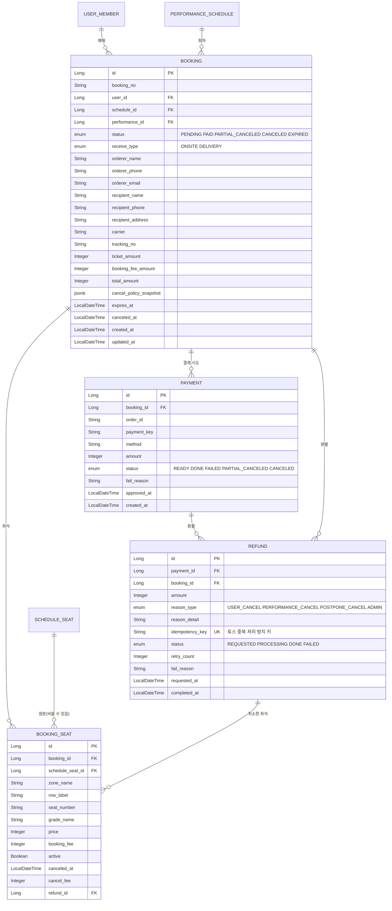

# 4부. 예매·결제 영역 (예매 · 예매 좌석 · 결제 · 환불)

> 이 부에서 다루는 테이블은 **4개**입니다. 사용자가 좌석을 고르고 돈을 내는 흐름이 전부 여기서 일어납니다.
> `booking`, `booking_seat`, `payment`, `refund`
>
> 읽고 나면 알게 되는 것
> - 좌석을 고르고 결제가 끝날 때까지 어떤 테이블이 어떤 순서로 바뀌는지
> - 왜 예매 좌석에 구역·열·번호·가격을 **복사**해 두는지
> - 결제가 실패하거나 취소(전체·일부)할 때 무엇이 일어나는지

**컬럼 표 읽는 법**: 금색 열쇠 = **PK**, 분홍색 열쇠 = **FK**. 타입은 자바 기준(`jsonb`는 PostgreSQL의 JSON 컬럼), NULL은 "비워 둬도 되는지"입니다. 테이블 그림은 이미지(`p4-*.png`)로도 있습니다.

---

## 이 부의 ERD



---

## 4-1. 큰 그림: 네 테이블의 역할

| 테이블 | 한 줄 설명 | 비유 |
|---|---|---|
| `booking` | 한 번의 예매 (누가, 어느 회차를, 총 얼마에) | 주문서 |
| `booking_seat` | 그 예매에 포함된 좌석 한 자리 한 자리 | 주문서의 상품 줄 |
| `payment` | 토스에 결제를 요청하고 승인받은 기록 | 카드 영수증 |
| `refund` | 돈을 돌려준 기록 | 환불 영수증 |

```
좌석 선택 ─→ [한 트랜잭션] 사용자별 매수 검사 → schedule_seat 임시 점유 (3부)
                          → booking(PENDING) + booking_seat
          ─→ 결제 준비 ─→ payment(READY)
          ─→ 토스 결제창
          ─→ 승인 성공 ─→ payment(DONE), booking(PAID), schedule_seat(SOLD)
```

**Q. 왜 `booking`과 `payment`가 따로인가요?**

결제는 **여러 번 시도**할 수 있기 때문입니다. 카드 한도 초과로 실패한 뒤 다른 카드로 다시 결제하면 예매는 하나인데 결제 기록은 둘입니다. 그래서 `booking : payment = 1 : N`입니다.

**Q. 왜 `refund`를 따로 두나요?**

환불은 **성공할 수도 실패할 수도 있고, 여러 번 일어날 수 있기** 때문입니다. 공연이 취소되면 수백 건을 한꺼번에 환불하는데 그중 일부가 실패할 수 있고, 관리자가 실패 건만 다시 처리해야 합니다. 환불 상태를 예매에 섞으면 "취소는 됐는데 환불은 안 된" 상태를 표현하기 어렵습니다.

---

## 4-2. 예매: `booking`

**예매** · `booking`

| 키 | 한글명 | 컬럼 | 타입 | NULL | 설명 |
|---|---|---|---|---|---|
| PK | 예매 번호 | `id` | Long | NOT NULL | 내부용 번호 |
|  | 예매 번호(노출용) | `booking_no` | String | NOT NULL | 날짜+랜덤. 예: 20261109KCZB03R. 중복 불가 |
| FK | 예매자 | `user_id` | Long | NOT NULL | (user_member) |
| FK | 회차 번호 | `schedule_id` | Long | NOT NULL | 어느 회차의 예매인지 (performance_schedule) |
| FK | 공연 번호 | `performance_id` | Long | NOT NULL | 그 회차가 속한 공연 (performance). 예매 때 복사해 둠. 공연 단위 매수 검사·조회용 |
|  | 상태 | `status` | enum | NOT NULL | PENDING 결제 대기 / PAID 결제 완료 / PARTIAL_CANCELED 일부 취소 / CANCELED 전체 취소 / EXPIRED 시간 초과 |
|  | 수령 방법 | `receive_type` | enum | NOT NULL | ONSITE 현장 / DELIVERY 배송 (예매자가 선택). 좌석을 점유할 때는 기본값(공연이 BOTH면 ONSITE)을 넣고, 결제 준비 때 확정 |
|  | 주문자 이름 | `orderer_name` | String | NOT NULL | 예매 시점 값을 복사(스냅샷) |
|  | 주문자 연락처 | `orderer_phone` | String | NOT NULL | 스냅샷 |
|  | 주문자 이메일 | `orderer_email` | String | NOT NULL | 스냅샷 |
|  | 받는 사람 | `recipient_name` | String | NULL | 배송일 때만 |
|  | 받는 사람 연락처 | `recipient_phone` | String | NULL | 배송일 때만 |
|  | 배송 주소 | `recipient_address` | String | NULL | 배송일 때만 |
|  | 택배사 | `carrier` | String | NULL | 판매자가 발송 처리할 때 입력 |
|  | 송장번호 | `tracking_no` | String | NULL | 판매자가 발송 처리할 때 입력 |
|  | 티켓 금액 | `ticket_amount` | Integer | NOT NULL | 좌석 가격 합계 |
|  | 예매 수수료 | `booking_fee_amount` | Integer | NOT NULL | 좌석 수 x 공연의 예매 수수료 |
|  | 총 결제 금액 | `total_amount` | Integer | NOT NULL | 티켓 금액 + 예매 수수료 (최초 금액, 취소해도 바뀌지 않음) |
|  | 취소 규정 스냅샷 | `cancel_policy_snapshot` | jsonb | NOT NULL | 예매 시점의 취소 규정 구간을 통째로 복사 |
|  | 결제 제한 시각 | `expires_at` | LocalDateTime | NOT NULL | 좌석 점유 시작 + 7분 |
|  | 전체 취소 일시 | `canceled_at` | LocalDateTime | NULL | 전부 취소됐을 때만 |
|  | 생성일 | `created_at` | LocalDateTime | NOT NULL |  |
|  | 수정일 | `updated_at` | LocalDateTime | NOT NULL |  |

**Q. 예매 상태는 어떻게 흘러가나요?**

```
PENDING ──결제 성공──→ PAID ──일부 좌석 취소──→ PARTIAL_CANCELED ──나머지도 취소──→ CANCELED
   │                    └────────전체 취소───────────────────────────────────────────→ CANCELED
   └──7분 지나도 결제 안 함──→ EXPIRED
```

| 값 | 의미 |
|---|---|
| `PENDING` | 좌석을 잡고 결제를 기다리는 중 |
| `PAID` | 결제 완료 |
| `PARTIAL_CANCELED` | 일부 좌석만 취소됨 |
| `CANCELED` | 전체 취소됨 |
| `EXPIRED` | 결제 제한 시간(7분)이 지나 무효 |

처음 설계에 있던 `REFUND_FAILED`는 뺐습니다. **환불의 성공·실패는 `refund`가 가지므로** 예매 상태에는 섞지 않습니다.

**Q. `booking_no`는 왜 `id`와 따로 있나요?**

`id`는 DB 내부 번호라 외부에 보여주면 번호를 바꿔 가며 남의 예매를 조회하려는 시도가 쉬워집니다. 사용자에게 보이는 번호는 날짜 + 랜덤(`20261109KCZB03R`)으로 만들어 따로 둡니다.

**Q. 주문자 이름·연락처는 `user_member`에 있는데 왜 또 저장하나요?**

예매 시점의 값을 **복사(스냅샷)**해 두는 것입니다. 나중에 회원이 번호를 바꾸거나 탈퇴해도 "그때 예매할 때 쓴 연락처"가 남아 있어야 하고, 판매자와 관리자가 문의 대응에 쓰기 때문입니다.

**Q. `performance_id`는 `schedule_id`로 알 수 있는데 왜 또 저장하나요?**

예매 → 회차 → 공연으로 조인해야 공연을 알 수 있습니다. 1인 최대 매수 검사(4-7)와 판매자의 공연별 예매 목록이 모두 "공연 단위"로 조회해서, 조인을 한 번 줄이려고 예매 때 복사해 둡니다. 예매가 속한 공연은 바뀌지 않으므로 어긋날 일이 없습니다.

**Q. 총 금액은 취소하면 줄어드나요?**

줄어들지 않습니다. `total_amount`는 **처음 결제한 금액**입니다. 얼마가 환불됐는지는 `refund`를 합쳐서 알 수 있습니다. 원본 금액이 변하지 않아야 기록이 헷갈리지 않습니다.

**Q. 취소 규정을 JSON 컬럼(`jsonb`)에 통째로 저장하는 게 좋은 선택인가요?**

이 경우에는 좋은 선택입니다.

- 그 값은 **읽기만 하고 검색하거나 부분 수정하지 않습니다.** 환불 계산 때 꺼내서 쓰기만 합니다.
- 판매자가 나중에 규정을 바꿔도 **이미 한 예매는 예매 당시 규정**이 적용되어야 합니다.
- 구간 테이블을 또 만들어 복사하면 테이블과 조회가 늘어납니다.

```json
[
  { "daysFrom": 7, "daysTo": null, "feeRate": 0,  "cancelable": true },
  { "daysFrom": 3, "daysTo": 6,    "feeRate": 10, "cancelable": true },
  { "daysFrom": 1, "daysTo": 2,    "feeRate": 20, "cancelable": true },
  { "daysFrom": 0, "daysTo": 0,    "feeRate": 0,  "cancelable": false }
]
```

단점은 구간 구조를 나중에 바꾸면 옛 JSON은 옛 모양이라는 점인데, 읽는 코드가 필드가 없을 때를 처리하면 됩니다.

**Q. 배송은 어떻게 저장하나요?**

`booking`의 일반 컬럼(받는 사람, 연락처, 주소, 택배사, 송장번호)에 저장합니다. **배송 테이블은 만들지 않습니다.** 판매자가 발송 처리할 때 택배사와 송장번호를 입력하고, 사용자 화면은 택배사의 배송 조회 주소에 송장번호를 붙여 연결합니다. 택배사 조회 주소 형식은 바뀔 수 있어서 설정으로 관리합니다. (확장: 배송 테이블, 배송 상태 추적)

---

## 4-3. 예매 좌석: `booking_seat`

**예매 좌석** · `booking_seat`

| 키 | 한글명 | 컬럼 | 타입 | NULL | 설명 |
|---|---|---|---|---|---|
| PK | 예매 좌석 번호 | `id` | Long | NOT NULL |  |
| FK | 예매 번호 | `booking_id` | Long | NOT NULL | (booking) |
| FK | 판매 좌석 번호 | `schedule_seat_id` | Long | NULL | 끝난 회차의 좌석을 지우면 비게 됨 (schedule_seat) |
|  | 구역명 | `zone_name` | String | NOT NULL | 스냅샷. 예: F2구역 |
|  | 열 | `row_label` | String | NOT NULL | 스냅샷. 예: 9열 |
|  | 좌석 번호 | `seat_number` | String | NOT NULL | 스냅샷. 예: 6 |
|  | 등급명 | `grade_name` | String | NOT NULL | 스냅샷. 예: R석 |
|  | 좌석 가격 | `price` | Integer | NOT NULL | 스냅샷 |
|  | 예매 수수료 | `booking_fee` | Integer | NOT NULL | 스냅샷. 좌석 1장당 |
|  | 활성 여부 | `active` | Boolean | NOT NULL | 취소하면 false |
|  | 취소 일시 | `canceled_at` | LocalDateTime | NULL | 이 좌석을 취소한 시각 |
|  | 취소 수수료 | `cancel_fee` | Integer | NULL | 이 좌석 취소 때 계산한 수수료 |
| FK | 환불 번호 | `refund_id` | Long | NULL | 이 좌석을 취소하며 만든 환불 (refund) |

**Q. 구역명·열·번호·가격을 왜 또 저장하나요?**

원본(`schedule_seat`)이 없어져도 **"내가 어떤 좌석을 얼마에 샀는지"가 남아 있어야** 하기 때문입니다. 3부에서 정한 대로 끝난 회차의 판매 좌석은 일정 기간 뒤 삭제합니다. 그래서 `schedule_seat_id`는 **비어 있을 수 있게(NULL 허용)** 두고, 필요한 값은 이 테이블이 직접 갖습니다.

**Q. `active`는 뭔가요?**

취소된 좌석은 `false`가 됩니다. 취소된 좌석은 다시 `AVAILABLE`이 되어 **다른 사람에게 팔릴 수 있어서**, `schedule_seat_id`에 단순 UNIQUE를 걸 수 없습니다. 대신 **"활성인 예매 좌석만" 유일하도록** 부분 UNIQUE 인덱스를 겁니다.

```sql
CREATE UNIQUE INDEX uq_booking_seat_active
  ON booking_seat (schedule_seat_id) WHERE active;
```

이 인덱스가 **같은 좌석이 두 사람에게 동시에 팔리는 사고를 DB가 마지막으로 막아 주는 장치**입니다. (락이 뚫려도 여기서 걸립니다)

**Q. 부분 취소는 어떻게 표현하나요?**

예매 한 건에 좌석 3개가 있는데 1개만 취소하면, 그 좌석 행만 `active=false`, `canceled_at`, `cancel_fee`, `refund_id`가 채워집니다. 나머지 2개는 그대로 `active=true`입니다. 환불은 취소한 좌석 묶음마다 `refund` 1행이 생깁니다.

---

## 4-4. 결제: `payment`

**결제** · `payment`

| 키 | 한글명 | 컬럼 | 타입 | NULL | 설명 |
|---|---|---|---|---|---|
| PK | 결제 번호 | `id` | Long | NOT NULL |  |
| FK | 예매 번호 | `booking_id` | Long | NOT NULL | (booking). 결제 시도가 여러 번일 수 있음 |
|  | 주문 ID | `order_id` | String | NOT NULL | 토스에 보내는 orderId. 중복 불가. 승인 요청이 두 번 처리되지 않게 하는 키로도 씀 |
|  | 결제 키 | `payment_key` | String | NULL | 토스 승인 후에만 생김. 중복 불가 |
|  | 결제 수단 | `method` | String | NULL | 카드, 간편결제 등 (승인 후 기록) |
|  | 결제 금액 | `amount` | Integer | NOT NULL | 서버가 계산한 금액 |
|  | 상태 | `status` | enum | NOT NULL | READY 준비 / DONE 승인 / FAILED 실패 / PARTIAL_CANCELED 일부 환불 / CANCELED 전액 환불 |
|  | 실패 사유 | `fail_reason` | String | NULL |  |
|  | 승인 일시 | `approved_at` | LocalDateTime | NULL |  |
|  | 생성일 | `created_at` | LocalDateTime | NOT NULL |  |

**Q. 결제는 어떤 순서로 이루어지나요? (토스페이먼츠)**

1. 결제 준비 때 서버가 `payment`(`READY`)를 만듭니다. (`booking`과 `booking_seat`는 좌석을 점유할 때 이미 만들어져 있습니다.) 이때 **금액은 서버가 계산**하고 `order_id`를 발급합니다.
2. 프론트가 토스 결제창을 열고, 사용자가 결제합니다.
3. 결제창이 성공하면 `paymentKey`, `orderId`, `amount`를 들고 돌아옵니다.
4. 서버가 **금액이 내가 계산한 금액과 같은지 비교**한 뒤 토스에 **결제 승인**을 요청합니다. (클라이언트가 보낸 금액을 그대로 믿으면 안 됩니다)
5. 승인에 성공하면 `payment`=`DONE`, `booking`=`PAID`, 좌석=`SOLD`로 바꿉니다. **이 세 가지는 한 트랜잭션**입니다.
6. 실패하면 `payment`=`FAILED`와 사유를 기록하고, 좌석 점유는 시간이 지나면 풀립니다.

처음에는 **Mock(가짜) 결제**로 흐름을 먼저 만들고, 나중에 실제 토스로 바꿉니다. 이때 `payment` 구조는 그대로입니다.

**Q. 결제 수단은 어떻게 하나요?**

토스 결제창에 맡깁니다. 어떤 수단으로 결제했는지는 승인 후 `method`에 기록만 합니다.

---

## 4-5. 환불: `refund`

**환불** · `refund`

| 키 | 한글명 | 컬럼 | 타입 | NULL | 설명 |
|---|---|---|---|---|---|
| PK | 환불 번호 | `id` | Long | NOT NULL |  |
| FK | 결제 번호 | `payment_id` | Long | NOT NULL | 환불할 결제 (payment) |
| FK | 예매 번호 | `booking_id` | Long | NOT NULL | (booking) |
|  | 환불 금액 | `amount` | Integer | NOT NULL | 이번 환불로 돌려주는 금액 |
|  | 환불 사유 종류 | `reason_type` | enum | NOT NULL | USER_CANCEL 본인 취소 / PERFORMANCE_CANCEL 공연 취소 / POSTPONE_CANCEL 연기로 인한 취소 / ADMIN 관리자 처리 |
|  | 상세 사유 | `reason_detail` | String | NULL |  |
|  | 중복 방지 키 | `idempotency_key` | String | NOT NULL | 환불 행을 만들 때 정하는 UUID. 토스 요청 헤더(`Idempotency-Key`)로 보냄. 중복 불가 |
|  | 상태 | `status` | enum | NOT NULL | REQUESTED 요청됨 / PROCESSING 토스에 요청 중 / DONE 완료 / FAILED 실패 |
|  | 재시도 횟수 | `retry_count` | Integer | NOT NULL | 자동 재시도 3회까지 |
|  | 실패 사유 | `fail_reason` | String | NULL |  |
|  | 요청 일시 | `requested_at` | LocalDateTime | NOT NULL |  |
|  | 완료 일시 | `completed_at` | LocalDateTime | NULL |  |

**Q. 환불 금액은 어떻게 계산하나요?**

취소하는 시점의 남은 일수로 `booking.cancel_policy_snapshot`의 구간을 찾아 수수료율을 적용합니다.

```
좌석별 취소 수수료 = 좌석 가격 × 수수료율(%)        (원 단위 절사)
환불 금액 = Σ(좌석 가격 − 취소 수수료) + Σ(예매 수수료)
```

- 예매 수수료(`booking_fee`)는 **취소 시 돌려줍니다.** (제가 정한 기본값이며, 서비스 정책에 따라 바꿀 수 있습니다)
- **연기 무료 취소, 공연 취소, 판매자 취소**는 취소 수수료를 **0%**로 합니다. (연기 무료 취소 대상인지 판단하는 규칙은 3부 "연기가 생기면 어떤 테이블이 바뀌나요?"에 있습니다.)
- 취소 수수료 `cancelable=false` 구간(당일)에는 사용자 취소를 막습니다.

**Q. 환불이 실패하면요?**

- `refund.status`=`FAILED`로 두고 자동으로 **3회까지 재시도**(`retry_count`)합니다.
- 그래도 실패하면 관리자 화면에서 수동으로 다시 처리합니다. (5부)

**Q. `idempotency_key`와 `PROCESSING`은 왜 있나요?**

토스에 환불을 요청했는데 응답이 오기 전에 서버가 죽거나 시간 초과가 나면, 우리는 **환불이 됐는지 모릅니다.** 그냥 다시 요청하면 **이중 환불**이 될 수 있습니다.

- 환불 행을 만들 때 UUID를 `idempotency_key`로 정해 두고, 토스에 요청할 때 항상 **같은 키**를 헤더로 보냅니다. 같은 키로 다시 요청해도 토스가 중복 처리하지 않습니다. (토스 연동 때 공식 문서로 확인합니다.)
- 요청을 보내기 직전에 상태를 `PROCESSING`으로 바꿉니다. 서버가 죽은 뒤 `PROCESSING`인 채 오래 남은 건은 스케줄러가 토스에 조회해서 `DONE`이나 `FAILED`로 확정합니다. (5부)

---

## 4-6. 핵심 흐름 정리

### ① 예매하기 (정상)

| 순서 | 일어나는 일 | 바뀌는 테이블 |
|---|---|---|
| 1 | 좌석 선택 → 점유 요청 (**한 트랜잭션**, 4-7 참고) | 사용자별 매수 검사 → `schedule_seat`: `AVAILABLE` → `HELD`, `held_by`, `held_until` = 지금 + 7분 → `booking`(PENDING, `expires_at`, `performance_id`), `booking_seat`(스냅샷) **추가** |
| 2 | 결제 준비 | 수령 방법·배송지 확정, `payment`(READY) **추가** |
| 3 | 결제 승인 | `payment` → DONE, `booking` → PAID, `schedule_seat` → SOLD (한 트랜잭션) |

### ② 결제하지 않고 7분이 지남

| 일어나는 일 | 바뀌는 테이블 |
|---|---|
| 스케줄러가 만료된 점유를 정리 | `schedule_seat`: `HELD` → `AVAILABLE`, `held_by`·`held_until` 비움 |
| 예매 만료 처리 | `booking` → EXPIRED, `booking_seat.active` → false, `payment` → FAILED 또는 그대로 |

### ③ 일부 좌석 취소 (3장 중 1장)

| 순서 | 일어나는 일 | 바뀌는 테이블 |
|---|---|---|
| 1 | 규정 스냅샷으로 수수료 계산 | (읽기만) |
| 2 | 그 좌석 취소 처리 | `booking_seat`: `active` → false, `canceled_at`, `cancel_fee`, `refund_id` |
| 3 | 좌석을 되돌림 | `schedule_seat`: `SOLD` → `AVAILABLE` |
| 4 | 토스에 **부분 취소** 요청 | `refund` 1행 추가 → 성공 시 DONE |
| 5 | 상태 갱신 | `payment` → PARTIAL_CANCELED, `booking` → PARTIAL_CANCELED |

마지막 남은 좌석까지 취소하면 `booking`은 `CANCELED`, `payment`는 `CANCELED`가 됩니다.

### ④ 공연 취소·연기 무료 취소

판매자가 회차를 취소하면 그 회차의 `PAID`/`PARTIAL_CANCELED` 예매 전부에 대해 **수수료 0%로 환불**을 일괄 생성합니다. 연기는 3부 흐름대로 사용자가 직접 취소할 때 개별 환불이 생깁니다.

---

## 4-7. 같이 알아둘 것

**Q. 동시에 같은 좌석을 눌러도 안 꼬이는 이유는?**

세 겹으로 막습니다.

1. `schedule_seat` 행을 `SELECT ... FOR UPDATE`로 잠그고 `AVAILABLE`일 때만 `HELD`로 바꿉니다. (기본 방어)
2. `version` 비교로 낙관적 락 방식도 실험할 수 있습니다.
3. 마지막으로 `booking_seat`의 **부분 UNIQUE 인덱스**가 중복 판매를 막습니다.

**Q. 결제는 됐는데 서버가 죽어서 예매가 `PAID`로 안 바뀌면요?**

토스에서는 결제가 됐는데 우리 DB는 `PENDING`인 상태가 생길 수 있습니다. 그래서 `payment`가 `READY`인 채 오래된 건을 주기적으로 **토스에 조회해서 맞춰 주는 보정 작업**이 필요합니다. (5부에서 문제 상황으로 다룹니다)

### 1인 최대 매수 (공연 전체 누적)

`performance.max_per_person`은 **한 공연의 모든 회차를 합쳐서** 한 사람이 가질 수 있는 좌석 수입니다.

**세는 방법**

```sql
SELECT count(*) FROM booking_seat bs
JOIN booking b ON b.id = bs.booking_id
WHERE b.user_id = :userId AND b.performance_id = :performanceId AND bs.active
```

- `active`인 좌석만 셉니다. 결제 대기(PENDING)와 결제 완료는 포함되고, 취소·만료된 좌석은 `active=false`라서 빠집니다. (취소하면 다시 살 수 있음. **임시 정책**)
- 별도 카운터 컬럼을 두지 않고 **실제 데이터를 셉니다.** 카운터는 빠르지만 취소·만료·스케줄러가 돌 때마다 맞춰야 해서 값이 어긋나기 쉽습니다.
- 좌석 점유와 예매 생성을 한 트랜잭션으로 묶었기 때문에(4-6 ①) 기준이 `booking_seat` 하나로 끝납니다. "점유는 했는데 예매 행은 아직 없는" 좌석이 없습니다.

**동시에 요청하면 뚫립니다**

한도가 4장인 사람이 탭 두 개(또는 매크로)로 동시에 3장씩 요청하면 이렇게 됩니다.

```
요청 A: 현재 0장 → 3장 요청 → 통과        요청 B: 현재 0장 → 3장 요청 → 통과
결과: 6장 확보 (한도 초과)
```

같은 좌석은 부분 UNIQUE 인덱스가 최후로 막아 주지만, "사람별 합계"는 여러 행에 걸친 규칙이라 DB 제약으로 막을 수 없습니다. **잠금이 유일한 방어선**입니다.

**점유 요청 트랜잭션의 순서**

1. **사용자·공연 단위 잠금**을 잡습니다. 트랜잭션이 끝나면 자동으로 풀립니다.
   ```sql
   SELECT pg_advisory_xact_lock(hashtextextended(:userId || ':' || :performanceId, 0));
   ```
   (대안: `user_member` 행을 `FOR UPDATE`로 잠그기. 더 단순하지만 같은 회원의 다른 갱신과 부딪힙니다.)
2. 위 쿼리로 현재 활성 매수를 세고, `현재 + 요청 매수 > max_per_person`이면 거절합니다.
3. 좌석을 **id 오름차순**으로 잠그고 `HELD`로 바꿉니다.
4. `booking`(PENDING)과 `booking_seat`를 만듭니다.

잠금 순서는 항상 **"사용자 잠금 → 좌석 잠금(id 오름차순)"**으로 고정해야 데드락이 안 생깁니다. 서로 다른 사용자는 사용자 잠금에서 부딪히지 않아서, 인기 공연에서도 병목은 좌석 행 하나입니다.

**테스트**: 같은 사용자가 스레드 10개로 동시에 요청해도 한도를 넘지 않는 **동시성 테스트**를 만듭니다. 사용자 잠금을 빼면 이 테스트가 실패한다는 것도 같이 보여 줍니다. (좌석 중복 방지 테스트와 한 쌍)

**정리: 정책 (임시)**

| 항목 | 정한 값 |
|---|---|
| 취소·만료한 좌석 | 한도에서 빠짐 (취소하면 다시 구매 가능) |
| `max_per_person` 수정 | 예매가 생긴 뒤에는 늘리는 것만 가능 |
| 한 번 요청한 매수 | 요청 매수 자체가 남은 한도를 넘으면 전체 거절 (일부만 잡지 않음) |

**조회에 쓰는 인덱스(권장)**

| 용도 | 인덱스 |
|---|---|
| 내 예매 목록 | `booking (user_id, created_at DESC)` |
| 공연별 1인 매수 검사 | `booking (user_id, performance_id)` |
| 회차별 예매 조회 (판매자, 공연 취소 일괄 환불) | `booking (schedule_id, status)` |
| 결제 대기 만료 처리 | `booking (status, expires_at)` |
| 활성 좌석 중복 방지 | UNIQUE `booking_seat (schedule_seat_id)` WHERE active |
| 환불 실패 재처리 | `refund (status)` |

---

## 4-8. 이 영역의 기능과 테이블 연결

| 기능 | 쓰는 테이블 | 핵심 동작 |
|---|---|---|
| 좌석 점유 (예매자) | `schedule_seat`, `booking`, `booking_seat` | 매수 검사 → `HELD` (7분) → PENDING 예매 + 스냅샷 생성 (한 트랜잭션, 4-7) |
| 결제 준비 | `booking`, `payment` | 수령 방법·배송지 확정, READY |
| 결제 승인 (토스) | `payment`, `booking`, `schedule_seat` | 금액 비교 → 승인 → PAID, SOLD (한 트랜잭션) |
| 내 예매 목록·상세 | `booking`, `booking_seat`, `performance_schedule` | 스냅샷 값으로 표시 |
| 예매 취소 (전체·일부) | `booking_seat`, `booking`, `refund`, `payment`, `schedule_seat` | 규정 계산 → 좌석 취소 → 토스 부분 취소 |
| 만료 처리 (스케줄러) | `schedule_seat`, `booking` | HELD, PENDING 정리 |
| 판매자 예매 목록 | `booking`, `booking_seat` | 회차별 조회, 내 사업체 공연만 |
| 배송 처리 (판매자) | `booking` | 택배사, 송장번호 입력 |
| 공연·회차 취소 시 일괄 환불 | `booking`, `refund`, `payment` | 수수료 0% 환불 일괄 생성 |
| 환불 실패 재처리 (관리자) | `refund` | 실패 건 재요청 (5부) |

---

## 4부 요약

- 예매는 **`booking`(주문서) + `booking_seat`(좌석 줄) + `payment`(결제) + `refund`(환불)** 네 테이블이다.
- 좌석을 잡고 **7분** 안에 결제해야 한다. 지나면 점유가 풀리고 예매는 `EXPIRED`다. 좌석 점유와 PENDING 예매 생성은 **한 트랜잭션**이다.
- **1인 최대 매수**는 공연 전체 누적이고, `booking_seat`의 활성 좌석을 세어 검사한다. 동시 요청은 사용자·공연 단위 잠금으로 막는다.
- `booking_seat`는 구역·열·번호·등급·가격을 **복사해서 저장**한다. 그래서 끝난 회차의 판매 좌석을 지워도 기록이 남는다.
- **부분 취소**가 가능하다. 취소한 좌석만 `active=false`가 되고, 환불은 취소 묶음마다 1행이다.
- 취소 규정은 예매 때 **JSON 컬럼으로 복사**해 둔다. 규정이 바뀌어도 이미 한 예매는 그대로다.
- 중복 판매는 **행 잠금 → 낙관적 락 → 부분 UNIQUE 인덱스** 세 겹으로 막는다.
- 환불은 `refund`가 상태를 따로 가지며, 실패하면 자동 3회 재시도 후 관리자가 처리한다. 환불마다 **중복 방지 키**를 두어, 응답이 끊겨도 이중 환불이 되지 않게 한다.

다음은 **5부. 감사 로그와 운영 문제 상황** (`audit_log`, 환불 실패 재처리, 결제 불일치 보정 등)입니다.
