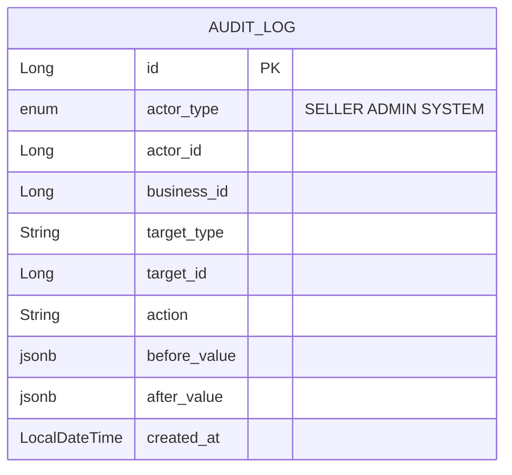

# 5부. 감사 로그와 운영 문제 상황

> 이 부에서 다루는 테이블은 **1개**입니다. `audit_log`
> 나머지는 서비스를 운영하다 보면 **반드시 생기는 문제 4가지**와 그때 시스템이 하는 일입니다.
>
> 읽고 나면 알게 되는 것
> - "누가 언제 무엇을 바꿨는지"를 어떻게 남기는지
> - 결제·환불·좌석에서 어긋남이 생겼을 때 어떻게 맞추는지
> - 사람이 하지 않아도 자동으로 도는 작업(스케줄러)이 무엇인지

**컬럼 표 읽는 법**: 금색 열쇠 = PK, 분홍색 열쇠 = FK. 타입은 자바 기준(`jsonb`는 PostgreSQL의 JSON 컬럼)입니다. 이 부의 테이블은 모두 FK가 없습니다. 이미지는 `p5-*.png`입니다.

---

## 이 부의 ERD



(다른 테이블과 선으로 연결되지 않습니다. 이유는 아래에 있습니다.)

---

## 5-1. 감사 로그: `audit_log`

**감사 로그** · `audit_log`

| 키 | 한글명 | 컬럼 | 타입 | NULL | 설명 |
|---|---|---|---|---|---|
| PK | 로그 번호 | `id` | Long | NOT NULL |  |
|  | 행위자 종류 | `actor_type` | enum | NOT NULL | SELLER 판매자 / ADMIN 관리자 / SYSTEM 시스템(스케줄러) |
|  | 행위자 번호 | `actor_id` | Long | NULL | 판매자·관리자 계정 번호. 시스템이면 비움. FK 없음 |
|  | 사업체 번호 | `business_id` | Long | NULL | 판매자 이력 조회용. 관리자·시스템 행동은 비울 수 있음 |
|  | 대상 종류 | `target_type` | String | NOT NULL | 예: PERFORMANCE, SCHEDULE, SELLER_BUSINESS, REFUND |
|  | 대상 번호 | `target_id` | Long | NOT NULL | 바뀐 대상의 번호 |
|  | 행동 | `action` | String | NOT NULL | 예: UPDATE, PAUSE, POSTPONE, CANCEL, APPROVE, RETRY |
|  | 변경 전 값 | `before_value` | jsonb | NULL | 바뀌기 전 내용 |
|  | 변경 후 값 | `after_value` | jsonb | NULL | 바뀐 뒤 내용 |
|  | 기록 일시 | `created_at` | LocalDateTime | NOT NULL | 추가만 하고 수정·삭제하지 않음 |

**Q. 감사 로그는 언제 쓰나요?**

"공연 가격이 왜 바뀌었지?", "이 회차를 누가 연기했지?" 같은 질문에 답하기 위해서입니다. 문제가 생겼을 때 **추적**하고, 판매자와 관리자의 행동 이력을 **확인**하는 용도입니다.

**Q. 어떤 행동을 남기나요?**

**판매자와 관리자의 변경 행동만** 남깁니다. 예매자의 예매·결제는 `booking`, `payment`가 이미 기록이라 제외합니다.

| 대상 (`target_type`) | 남기는 행동 (`action`) |
|---|---|
| 공연 | 수정, 공개, 취소 |
| 회차 | 추가, 판매 중지·재개, 연기, 취소 |
| 등급·가격 | 변경 |
| 판매 좌석 | 보류석 지정·해제 |
| 사업체 | 승인, 반려 (관리자) |
| 공통 안내 | 수정 (관리자) |
| 환불 | 수동 재처리 (관리자) |
| 시스템 작업 | 결제 불일치 자동 보정 등 (행위자 `SYSTEM`) |

**Q. 변경 전후 값을 왜 JSON 컬럼(`jsonb`)에 넣나요?**

바뀌는 대상(공연, 회차, 환불 …)마다 컬럼이 다르기 때문입니다. 대상마다 로그 테이블을 만들 수는 없으니, "바뀌기 전 내용"과 "바뀐 뒤 내용"을 JSON으로 통째로 저장합니다. 읽기만 하고 검색하지 않아서 이 방식이 잘 맞습니다.

```json
// before_value
{ "status": "ON_SALE" }
// after_value
{ "status": "POSTPONED", "newStartAt": null }
```

**Q. 왜 다른 테이블과 FK로 연결하지 않나요?**

- 행위자가 판매자, 관리자, 시스템 중 하나이고, 계정 테이블이 서로 다릅니다. 하나의 FK로는 가리킬 수 없습니다. 그래서 `actor_type + actor_id` 방식입니다.
- 대상도 공연, 회차, 환불 등 제각각이라 `target_type + target_id`로 가리킵니다.
- 계정이나 공연이 지워져도 **로그는 남아야** 하기 때문입니다.

**Q. 로그를 지우거나 고칠 수 있나요?**

안 됩니다. **추가만 합니다.** 고칠 수 있는 로그는 증거가 되지 못합니다.

**Q. 누가 볼 수 있나요?**

- 관리자: 전체
- 판매자: **자기 사업체의 로그만** (`business_id`로 필터)

**Q. 로그가 계속 쌓이면요?**

보관 기간을 제한하지 않고 쌓습니다. 값이 많아지면 **오래된 로그를 JSON Lines 같은 파일 형식으로 S3 같은 저장소에 옮기고 DB에서는 지우는 방식**으로 확장합니다. (예: 매월 한 달치씩 파일로 내보내기) 이번 범위에서는 만들지 않고 확장 항목으로 둡니다.

**조회에 쓰는 인덱스(권장)**

| 용도 | 인덱스 |
|---|---|
| 판매자 이력 조회 | `(business_id, created_at DESC)` |
| 특정 대상의 변경 이력 | `(target_type, target_id)` |

---

## 5-2. 서비스를 운영하면 반드시 생기는 문제 4가지

사용자가 직접 겪지 않아도, 시스템이 알아서 맞춰 줘야 하는 일들입니다.

### ① 결제하지 않고 떠난 좌석 정리 (만료 점유)

**무슨 일이 생기나**: 사용자가 좌석을 잡아 두고 결제하지 않은 채 창을 닫습니다. 정리하지 않으면 그 좌석이 영영 `HELD`로 남아 팔리지 않습니다.

**누가 처리하나**: 스케줄러(시스템)가 **1분마다** 처리합니다.

| 단계 | 바뀌는 테이블 |
|---|---|
| `held_until`이 지난 `HELD` 좌석을 찾는다 | (조회) |
| 좌석을 되돌린다 | `schedule_seat`: `HELD` → `AVAILABLE`, `held_by`·`held_until` 비움 |
| 결제 제한 시각이 지난 예매를 만료 처리 | `booking`: `PENDING` → `EXPIRED`, `booking_seat.active` → false |

서버를 여러 대 띄워도 같은 좌석을 두 번 처리하지 않도록 `FOR UPDATE SKIP LOCKED`로 이미 잠긴 행은 건너뜁니다.

### ② 결제는 됐는데 예매가 안 바뀐 경우 (결제 불일치 보정)

**무슨 일이 생기나**: 토스에서는 결제가 끝났는데, 그 직후 서버가 죽거나 네트워크가 끊기거나 사용자가 브라우저를 닫아서 우리 DB는 `PENDING`으로 남습니다.

```
토스: 결제 완료 (돈 나감)  ─ ✂ 여기서 끊김
우리 DB: booking = PENDING 그대로
```

- 사용자는 돈이 나갔는데 **예매가 없습니다.**
- 7분이 지나 좌석이 풀리면 **다른 사람에게 또 팔릴 수 있습니다.** (이중 판매)

**누가 처리하나**: 스케줄러가 **5분마다** `payment`가 `READY`로 남은 오래된 건을 찾아 **토스에 결제 조회**를 하고 맞춥니다.

| 토스 조회 결과 | 처리 | 바뀌는 테이블 |
|---|---|---|
| 결제됨 + 좌석이 아직 내 것 | 예매 확정 | `payment` → DONE, `booking` → PAID, `schedule_seat` → SOLD |
| 결제됨 + 좌석이 이미 풀렸거나 팔림 | **자동 환불** (사유 `SYSTEM`) | `refund` 추가(REQUESTED), `booking` → CANCELED, `audit_log`(SYSTEM) |
| 결제 안 됨 | 만료 처리 | `payment` → FAILED, `booking` → EXPIRED |

Mock 결제 단계에서는 이 작업의 틀만 만들고, 실제 토스를 붙일 때 조회 호출을 채웁니다.

### ③ 환불이 실패한 경우 (환불 재처리)

**무슨 일이 생기나**: 토스 환불 요청이 실패합니다. (네트워크 오류, 일시적 장애 등) 사용자는 취소했는데 돈을 못 받은 상태입니다.

| 단계 | 처리 | 바뀌는 테이블 |
|---|---|---|
| 1 | 환불 요청이 실패하면 상태를 기록 | `refund`: `FAILED`, `fail_reason` |
| 2 | **자동으로 3회까지** 재시도 | `refund`: `retry_count` 증가, 성공하면 `DONE` |
| 3 | 3회 모두 실패하면 관리자 화면의 **"환불 실패" 목록**에 표시 | (조회: `refund.status = FAILED`) |
| 4 | 관리자가 원인을 확인하고 **수동 재처리** | `refund` 갱신, `audit_log`(관리자, 환불 재처리) |

이메일·슬랙 알림은 확장 항목입니다.

**서버가 환불 요청 도중 죽은 경우**: 요청을 보내기 직전에 `refund`를 `PROCESSING`으로 바꿔 두므로, 오래 남은 `PROCESSING` 건(예: 5분 이상)은 스케줄러가 **같은 `idempotency_key`**로 토스에 조회·재요청해서 `DONE`이나 `FAILED`로 확정합니다. 이중 환불이 생기지 않는 이유가 이 키입니다. (4부)

### ④ 공연·회차가 취소된 경우 (일괄 환불)

**무슨 일이 생기나**: 판매자가 회차(또는 공연)를 취소하면 그 회차의 **예매 수백 건을 한꺼번에 환불**해야 합니다. 이 중 일부는 실패할 수 있습니다.

| 순서 | 처리 | 바뀌는 테이블 |
|---|---|---|
| 1 | 판매자가 회차를 취소 | `performance_schedule`: `CANCELED`, `audit_log`(판매자, 취소) |
| 2 | 그 회차의 `PAID`·`PARTIAL_CANCELED` 예매를 모두 찾는다 | (조회) |
| 3 | 예매마다 **수수료 0%**로 환불 요청을 만든다 | `refund` 여러 행 추가 (사유 `PERFORMANCE_CANCEL`, `REQUESTED`) |
| 4 | 요청을 **하나씩 차례로** 토스에 보내 처리 (한꺼번에 몰아서 보내지 않음) | 성공 → `refund` `DONE`, `payment` `CANCELED`, `booking` `CANCELED` |
| 5 | 실패한 건은 ③ 흐름으로 | `refund` `FAILED` → 자동 재시도 → 관리자 목록 |

**왜 요청을 먼저 만들어 두고 따로 처리하나요?** 서버가 중간에 죽어도 `refund`에 `REQUESTED`로 남아 있으니 **이어서 처리할 수 있기 때문**입니다.

---

## 5-3. 자동으로 도는 작업(스케줄러) 모음

| 작업 | 주기 | 대상 | 하는 일 |
|---|---|---|---|
| 만료 점유 정리 | 1분 | `schedule_seat`, `booking` | `HELD` 되돌리기, `PENDING` 만료 |
| 결제 불일치 보정 | 5분 | `payment`, `booking`, `refund` | 토스 조회 후 확정·환불·만료 |
| 환불 재시도 | 1~5분 | `refund` | `FAILED` 중 재시도 3회 미만인 건 재요청, 오래된 `PROCESSING` 건 토스 조회 후 확정 |
| 일괄 환불 처리 | 수시 | `refund` | `REQUESTED` 건을 차례로 처리 |
| 끝난 회차 좌석 정리 | 하루 1회 | `schedule_seat` | 공연 후 30일이 지난 회차의 판매 좌석 삭제 (3부) |
| 판매 좌석 생성 | 1시간 | `performance_schedule`, `schedule_seat` | 판매 오픈 24시간 전이 된 회차의 좌석 복사. 실패하면 다음 주기에 재시도 (3부) |

환불 재시도와 일괄 환불 처리는 같은 작업(`REQUESTED`와 재시도 가능한 `FAILED`를 함께 처리)으로 합칠 수 있습니다.

---

## 5-4. 이 영역의 기능과 테이블 연결

| 기능 | 쓰는 테이블 | 핵심 동작 |
|---|---|---|
| 판매자·관리자 행동 기록 | `audit_log` | 변경 행동마다 한 줄 추가 (전·후 값 포함) |
| 판매자 이력 조회 | `audit_log` | 자기 사업체 로그만 |
| 관리자 전체 이력 조회 | `audit_log` | 행위자·대상·기간으로 검색 |
| 만료 점유 정리 | `schedule_seat`, `booking` | 1분 스케줄러 |
| 결제 불일치 보정 | `payment`, `booking`, `refund` | 5분 스케줄러 + 토스 조회 |
| 환불 실패 목록·재처리 (관리자) | `refund`, `audit_log` | `FAILED` 목록, 수동 재요청 |
| 회차·공연 취소 일괄 환불 | `booking`, `refund`, `payment` | 수수료 0% 환불 일괄 생성 |

---

## 5부 요약

- `audit_log`는 **판매자·관리자·시스템의 변경 행동**을 전·후 값(JSON)과 함께 **추가만** 하는 기록이다. FK를 걸지 않고 행위자·대상을 종류+번호로 가리킨다.
- 판매자는 자기 사업체 로그만, 관리자는 전체를 본다. 쌓이면 오래된 로그를 파일로 내보내 저장소(S3 등)로 옮긴다. (확장)
- 운영 문제는 네 가지다. **① 만료 점유 정리(1분)**, **② 결제 불일치 보정(5분, 토스 조회)**, **③ 환불 실패 재처리(자동 3회 → 관리자)**, **④ 공연 취소 일괄 환불**.
- 이 모든 것은 **상태를 가진 테이블**(`schedule_seat`, `booking`, `payment`, `refund`) 덕분에 "어디까지 처리됐는지"가 남아서, 중간에 서버가 죽어도 이어서 처리할 수 있다.

다음은 **부록** (기능과 테이블 전체 연결표, 개발 순서와 분담, 확장 테이블)입니다.
