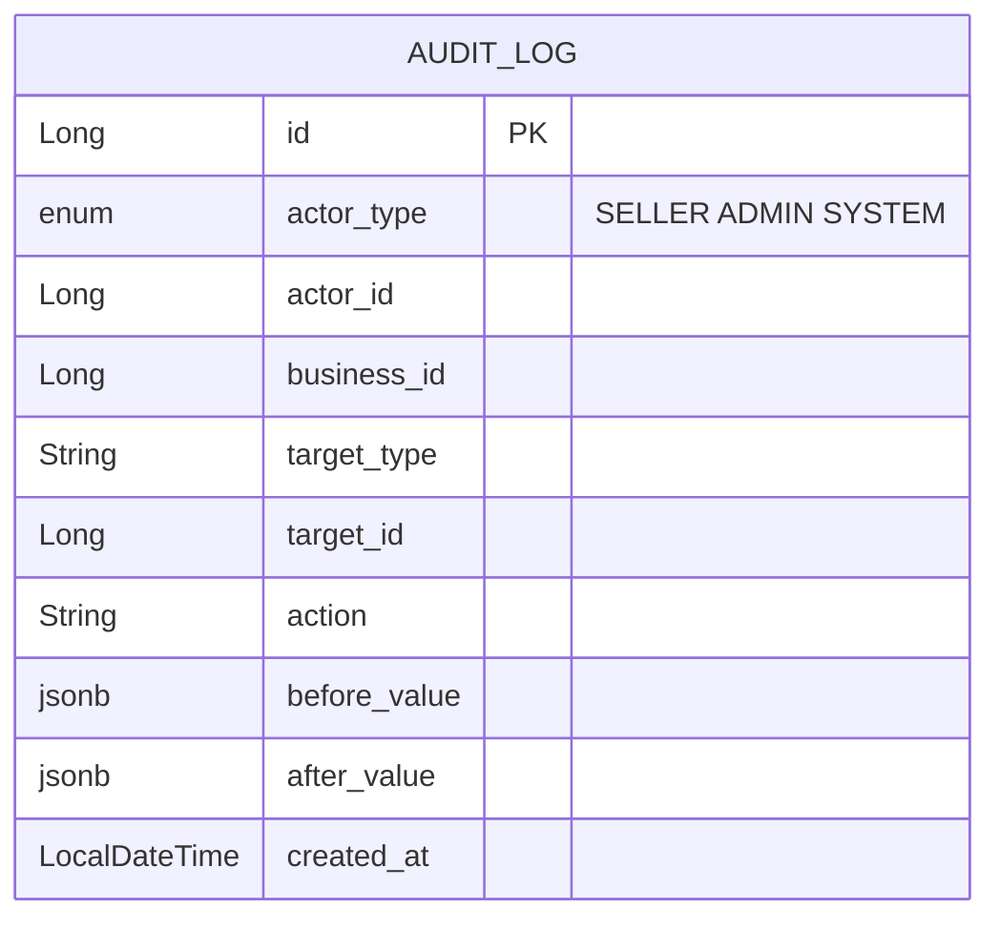

# 5부. 감사 로그와 운영 문제 상황

> 이 부에서 다루는 테이블은 **1개**입니다. `audit_log`
> 나머지는 서비스를 운영하다 보면 **반드시 생기는 문제 4가지**와 그때 시스템이 하는 일입니다.
>
> 읽고 나면 알게 되는 것
> - "누가 언제 무엇을 바꿨는지"를 어떻게 남기는지
> - 결제·환불·좌석에서 어긋남이 생겼을 때 어떻게 맞추는지
> - 사람이 하지 않아도 자동으로 도는 작업(스케줄러)이 무엇인지

**컬럼 표 읽는 법**: 금색 열쇠 = PK, 분홍색 열쇠 = FK. 타입은 자바 기준(`jsonb`는 PostgreSQL의 JSON 컬럼)입니다. 이 부의 테이블은 모두 FK가 없습니다. 이미지는 `p5-*.png`입니다.

---

## 이 부의 ERD



(다른 테이블과 선으로 연결되지 않습니다. 이유는 아래에 있습니다.)

---

## 5-1. 감사 로그: `audit_log`

**감사 로그** · `audit_log`

| 키 | 한글명 | 컬럼 | 타입 | NULL | 설명 |
|---|---|---|---|---|---|
| PK | 로그 번호 | `id` | Long | NOT NULL |  |
|  | 행위자 종류 | `actor_type` | enum | NOT NULL | SELLER 판매자 / ADMIN 관리자 / SYSTEM 시스템(스케줄러) |
|  | 행위자 번호 | `actor_id` | Long | NULL | 판매자·관리자 계정 번호. 시스템이면 비움. FK 없음 |
|  | 사업체 번호 | `business_id` | Long | NULL | 판매자 이력 조회용. 관리자·시스템 행동은 비울 수 있음 |
|  | 대상 종류 | `target_type` | String | NOT NULL | 예: PERFORMANCE, SCHEDULE, SELLER_BUSINESS, REFUND |
|  | 대상 번호 | `target_id` | Long | NOT NULL | 바뀐 대상의 번호 |
|  | 행동 | `action` | String | NOT NULL | 예: UPDATE, PAUSE, POSTPONE, CANCEL, APPROVE, RETRY |
|  | 변경 전 값 | `before_value` | jsonb | NULL | 바뀌기 전 내용 |
|  | 변경 후 값 | `after_value` | jsonb | NULL | 바뀐 뒤 내용 |
|  | 기록 일시 | `created_at` | LocalDateTime | NOT NULL | 추가만 하고 수정·삭제하지 않음 |

**Q. 감사 로그는 언제 쓰나요?**

"공연 가격이 왜 바뀌었지?", "이 회차를 누가 연기했지?" 같은 질문에 답하기 위해서입니다. 문제가 생겼을 때 **추적**하고, 판매자와 관리자의 행동 이력을 **확인**하는 용도입니다.

**Q. 어떤 행동을 남기나요?**

**판매자와 관리자의 변경 행동만** 남깁니다. 예매자의 예매·결제는 `booking`, `payment`가 이미 기록이라 제외합니다.

| 대상 (`target_type`) | 남기는 행동 (`action`) |
|---|---|
| 공연 | 수정, 공개, 취소 |
| 회차 | 추가, 판매 중지·재개, 연기, 취소 |
| 등급·가격 | 변경 |
| 판매 좌석 | 보류석 지정·해제 |
| 사업체 | 승인, 반려 (관리자) |
| 공통 안내 | 수정 (관리자) |
| 환불 | 수동 재처리 (관리자) |
| 시스템 작업 | 결제 불일치 자동 보정 등 (행위자 `SYSTEM`) |

**Q. 변경 전후 값을 왜 JSON 컬럼(`jsonb`)에 넣나요?**

바뀌는 대상(공연, 회차, 환불 …)마다 컬럼이 다르기 때문입니다. 대상마다 로그 테이블을 만들 수는 없으니, "바뀌기 전 내용"과 "바뀐 뒤 내용"을 JSON으로 통째로 저장합니다. 읽기만 하고 검색하지 않아서 이 방식이 잘 맞습니다.

```json
// before_value
{ "status": "ON_SALE" }
// after_value
{ "status": "POSTPONED", "newStartAt": null }
```

**Q. 왜 다른 테이블과 FK로 연결하지 않나요?**

- 행위자가 판매자, 관리자, 시스템 중 하나이고, 계정 테이블이 서로 다릅니다. 하나의 FK로는 가리킬 수 없습니다. 그래서 `actor_type + actor_id` 방식입니다.
- 대상도 공연, 회차, 환불 등 제각각이라 `target_type + target_id`로 가리킵니다.
- 계정이나 공연이 지워져도 **로그는 남아야** 하기 때문입니다.

**Q. 로그를 지우거나 고칠 수 있나요?**

안 됩니다. **추가만 합니다.** 고칠 수 있는 로그는 증거가 되지 못합니다.

**Q. 누가 볼 수 있나요?**

- 관리자: 전체
- 판매자: **자기 사업체의 로그만** (`business_id`로 필터)

**Q. 로그가 계속 쌓이면요?**

보관 기간을 제한하지 않고 쌓습니다. 값이 많아지면 **오래된 로그를 JSON Lines 같은 파일 형식으로 S3 같은 저장소에 옮기고 DB에서는 지우는 방식**으로 확장합니다. (예: 매월 한 달치씩 파일로 내보내기) 이번 범위에서는 만들지 않고 확장 항목으로 둡니다.

**조회에 쓰는 인덱스(권장)**

| 용도 | 인덱스 |
|---|---|
| 판매자 이력 조회 | `(business_id, created_at DESC)` |
| 특정 대상의 변경 이력 | `(target_type, target_id)` |

---

## 5-2. 서비스를 운영하면 반드시 생기는 문제 4가지

사용자가 직접 겪지 않아도, 시스템이 알아서 맞춰 줘야 하는 일들입니다.

### ① 결제하지 않고 떠난 좌석 정리 (만료 점유)

**무슨 일이 생기나**: 사용자가 좌석을 잡아 두고 결제하지 않은 채 창을 닫습니다. 정리하지 않으면 그 좌석이 영영 `HELD`로 남아 팔리지 않습니다.

**누가 처리하나**: 스케줄러(시스템)가 **1분마다** 처리합니다. 주기는 설정값으로 두어서, 부하 테스트에서 부담이 보이면 코드를 고치지 않고 바꿉니다. (7분처럼 길게 두면 점유가 풀린 뒤에도 잔여석 집계와 1인 매수 집계가 최대 그만큼 틀리게 보입니다)

| 단계 | 바뀌는 테이블 |
|---|---|
| 결제 제한 시각(`expires_at`)이 지난 `PENDING` 예매를 오래된 것부터 잠그며 찾는다 | (조회) |
| 그 예매를 만료 처리 | `booking`: `PENDING` → `EXPIRED`, `booking_seat.active` → false |
| 그 예매의 좌석을 되돌린다 | `schedule_seat`: `HELD` → `AVAILABLE`, `held_by`·`held_until` 비움 |

위 세 단계는 **한 트랜잭션**입니다. 좌석만 먼저 풀리면 낡은 `booking_seat`가 활성으로 남아 있어서, 그 좌석을 새로 점유한 요청이 `uq_booking_seat_active`와 부딪힙니다. 그래서 좌석의 `held_until`이 아니라 **만료된 예매를 기준으로** 그 예매의 좌석만 되돌립니다. (2026-11-17 변경: 좌석을 먼저 찾던 순서를 예매 기준으로 바꿈) 좌석 상태 조건(`HELD`일 때만)이 있어서 그 사이 결제가 끝나 `SOLD`가 된 좌석은 건드리지 않습니다.

서버를 여러 대 띄워도 같은 예매를 두 번 처리하지 않도록 `FOR UPDATE SKIP LOCKED`로 이미 잠긴 행은 건너뜁니다. 결제 승인이 같은 예매 행을 바꾸는 중이면 정리가 그 행을 건너뛰고, 승인이 먼저 끝나 만료 시각이 늘어났다면 다음 주기에도 대상이 아닙니다. 한 번에 처리하는 예매 수(`app.booking.expiry-batch-size`)를 제한해 트랜잭션과 잠금이 길어지지 않게 하고, 남았으면 이어서 처리합니다. 주기(`app.booking.expiry-interval`)와 켜고 끄는 값(`app.booking.expiry-enabled`)은 `application.yaml`의 설정값입니다.

### ② 결제는 됐는데 예매가 안 바뀐 경우 (결제 불일치 보정)

**무슨 일이 생기나**: 토스에서는 결제가 끝났는데, 그 직후 서버가 죽거나 네트워크가 끊기거나 사용자가 브라우저를 닫아서 우리 DB는 `PENDING`으로 남습니다.

```
토스: 결제 완료 (돈 나감)  ─ ✂ 여기서 끊김
우리 DB: booking = PENDING 그대로
```

- 사용자는 돈이 나갔는데 **예매가 없습니다.**
- 7분이 지나 좌석이 풀리면 **다른 사람에게 또 팔릴 수 있습니다.** (이중 판매)

**누가 처리하나**: 스케줄러가 **5분마다** `payment`가 `PROCESSING`으로 남은 오래된 건을 찾아 **토스에 결제 조회**를 하고 맞춥니다. (`PROCESSING`은 결제 승인을 시작한 뒤 서버가 죽거나 토스 응답을 받지 못한 건입니다) `READY`로 오래 남은 건은 토스에 조회하지 않고 바로 닫습니다. (아래 "고민")

| 토스 조회 결과 | 처리 | 바뀌는 테이블 |
|---|---|---|
| 결제됨 + 좌석이 아직 내 것 | 예매 확정 | `payment` → DONE, `booking` → PAID, `schedule_seat` → SOLD |
| 결제됨 + 좌석이 이미 풀렸거나 팔림 | **자동 환불** (사유 `SYSTEM`) | `refund` 추가(REQUESTED), `booking` → CANCELED, `audit_log`(SYSTEM) |
| 결제 안 됨 | 만료 처리 | `payment` → FAILED, `booking` → EXPIRED |

**구현했습니다**(2026-11-25, `PaymentReconcileFacade`·`PaymentReconcileScheduler`). 위 표에서 정하지 않았던 부분은 아래처럼 정했습니다.

- **조회는 주문 ID로 합니다.** 응답을 잃은 결제는 결제 키를 모르기 때문입니다. (토스 `GET /v1/payments/orders/{orderId}`) 주문서형·결제창형 연동 키(`test_gsk_`, `live_gsk_`)로는 이 API를 부를 수 없고 개별 연동 키(`test_sk_`, `live_sk_`)여야 합니다.
- **조회 결과는 돈이 나갔는지로 셋으로 나눕니다.** 결제됨(`DONE`), 결제 안 됨(조회되는 결제가 없음 `NOT_FOUND_PAYMENT`, `ABORTED`·`EXPIRED`·`CANCELED`), 아직 모름(그 밖의 상태와 조회 실패). **모르면 아무것도 바꾸지 않고** 다음 주기에 다시 조회합니다. 토스가 끝나지 않았다고만 답하는 결제는 1시간이 지나면 결제 안 됨으로 봅니다. (토스는 결제 요청 뒤 10분 안에 승인하지 않으면 결제 정보를 지우고, 우리는 승인을 다시 보내지 않아서 그 뒤에는 결제될 수 없습니다)
- **결제됨이면 예매가 아직 결제 대기(`PENDING`)인지로 가릅니다.** 결제 대기인 예매는 활성 예매 좌석의 UNIQUE 인덱스 때문에 그 좌석을 다른 사람이 잡을 수 없으므로 "좌석이 아직 내 것"입니다. 결제 대기가 아니면(만료됐거나 다른 결제로 이미 결제 완료) 받은 돈을 전액 환불합니다. 다른 결제로 이미 결제 완료된 예매는 **중복 결제만 환불하고 예매는 그대로** 둡니다.
- **결제 안 됨이어도 같은 예매에 진행 중이거나 승인된 다른 결제가 있으면 예매는 건드리지 않습니다.** 결제 준비는 이전 결제가 승인 중이어도 새 결제를 만들어서, 한 예매에 결제가 여러 건 있을 수 있습니다.
- **돈이 걸린 일은 자동으로 하지 않습니다.** 토스가 결제됐다고 한 금액이 우리가 계산한 금액과 다르면 아무것도 바꾸지 않고 오류 로그를 남겨 사람이 확인하게 합니다.
- **자동 환불을 토스에 보내는 일이 실패하면** 환불이 `FAILED`로 남아 ③의 환불 재시도 작업이 같은 멱등키로 이어서 처리합니다.
- **서버가 여러 대여도 안전합니다.** 결제를 바꾸는 쪽은 결제 승인·예매 취소와 같은 예매 단위 락 안에서 결제가 아직 닫히지 않았는지 다시 확인해서, 먼저 끝낸 쪽이 있으면 아무것도 하지 않습니다.
- **서버가 여러 대여도 낭비하지 않습니다.** 서버들이 같은 오래된 결제부터 고르기 때문에, 결제마다 선점 락(`reconcile-payment:{id}`)을 기다리지 않고 시도해서 다른 서버가 처리 중인 결제는 건너뛰고 다음 결제로 넘어갑니다. 락이 없으면 두 서버가 같은 결제를 토스에 중복 조회하고, 서버를 늘려도 처리량이 그대로입니다. (부하 시험 r4)
- **조회 대상과 순서**: 승인 중(`PROCESSING`)은 **승인을 시작한 지** 5분이 지난 것을 오래된 순으로 **먼저** 100건, 준비(`READY`)는 준비한 지 15분이 지난 것을 그다음 500건까지 고릅니다. 5분은 지금 토스에서 응답을 기다리는 승인(응답 제한 10초)을 건드리지 않게 하려는 것이고, 승인을 시작한 시각 `payment.processing_started_at`을 따로 둔 이유도 같습니다. (모든 값은 임시값이고 설정 `app.payment.reconcile.*`에 있습니다)
- **고민 (2026-11-26 부하 시험 후 바꿈)**: 처음에는 이 문서대로 준비(`READY`)도 토스에 조회했고 두 종류를 오래된 순으로 함께 100건씩 골랐습니다. 부하 시험(`doc/load-test-plan.md` 20장)에서 문제가 셋 나왔습니다. ① 오픈 때 결제 준비만 하고 이탈한 건이 몰리면(3분에 약 3,200건) 처리 한계(100건/5분 = 시간당 1,200건)를 넘어 적체가 풀리지 않았습니다. ② 오래된 준비가 먼저 나가서, 돈이 걸린 승인 중 56건이 15분 넘게 순서를 받지 못했습니다. ③ 서버 2대가 같은 건을 둘 다 조회해 토스 호출이 2배였고 처리량은 늘지 않았습니다. 그래서 (a) 준비는 토스에 조회하지 않고 닫습니다. 준비는 승인을 한 번도 시도하지 않은 상태라 토스에서 결제될 수 없고(승인 요청은 반드시 결제를 승인 중으로 바꾼 뒤 토스를 부릅니다), 닫은 뒤 늦게 승인 요청이 와도 결제가 준비 상태가 아니라 거절돼서 돈이 나가지 않습니다. 그 사이 승인 요청이 준비를 승인 중으로 바꿨다면 락 안에서 상태가 달라진 것을 보고 닫지 않고 다음 주기에 승인 중으로 조회합니다. (b) 승인 중을 먼저 고릅니다. (c) 위의 결제별 선점 락을 둡니다. 버린 대안은 한 번에 건수만 늘리는 것인데, 토스를 한 건씩 차례로 조회해서 토스가 느리면(0.5초면 100건에 50초) 건수를 늘려도 주기가 길어질 뿐이라 근본 해결이 아니었습니다.

### ③ 환불이 실패한 경우 (환불 재처리)

**무슨 일이 생기나**: 토스 환불 요청이 실패합니다. (네트워크 오류, 일시적 장애 등) 사용자는 취소했는데 돈을 못 받은 상태입니다.

| 단계 | 처리 | 바뀌는 테이블 |
|---|---|---|
| 1 | 환불 요청이 실패하면 상태를 기록 | `refund`: `FAILED`, `fail_reason` |
| 2 | **자동으로 3회까지** 재시도 | `refund`: `retry_count` 증가, 성공하면 `DONE` |
| 3 | 3회 모두 실패하면 관리자 화면의 **"환불 실패" 목록**에 표시 | (조회: `refund.status = FAILED`) |
| 4 | 관리자가 원인을 확인하고 **수동 재처리** (처음 요청 후 15일 안에만. 토스 멱등키 유효 기간) | `refund` 갱신, `audit_log`(관리자, 환불 재처리) |

이메일·슬랙 알림은 확장 항목입니다.

**재시도 간격**: 스케줄러는 1분마다 돌고, `last_attempted_at`(마지막으로 토스에 보낸 시각)에서 **5분**이 지난 환불만 다시 보냅니다. 3번의 재시도가 15분에 걸쳐 나뉘어서 토스가 잠깐 멈춘 정도로는 바로 관리자 목록에 올라가지 않고, 토스 응답 제한(10초)보다 충분히 길어서 응답을 기다리는 중인 환불을 다시 보내지 않습니다. 여러 서버가 같은 환불을 가져가는 일은 상태·시각 조건을 건 UPDATE가 막습니다(먼저 가져간 서버가 시각을 올려서 나머지는 0행).

**서버가 환불 요청 도중 죽은 경우**: 요청을 보내기 직전에 `refund`를 `PROCESSING`으로 바꿔 두므로, 마지막 시도 후 5분 넘게 남은 `PROCESSING` 건은 스케줄러가 **같은 `idempotency_key`**로 토스에 재요청해서 `DONE`이나 `FAILED`로 확정합니다. 이중 환불이 생기지 않는 이유가 이 키입니다. (4부) 돈이 나갔는지 모르는 상태라 **재시도 횟수와 상관없이** 다시 보내고, 보낸 횟수는 `retry_count`에 그대로 셉니다.

### ④ 공연·회차가 취소된 경우 (일괄 환불)

**무슨 일이 생기나**: 판매자가 회차(또는 공연)를 취소하면 그 회차의 **예매 수백 건을 한꺼번에 환불**해야 합니다. 이 중 일부는 실패할 수 있습니다.

| 순서 | 처리 | 바뀌는 테이블 |
|---|---|---|
| 1 | 판매자가 회차를 취소 | `performance_schedule`: `CANCELED`, `audit_log`(판매자, 취소) |
| 2 | 그 회차의 `PAID`·`PARTIAL_CANCELED` 예매를 모두 찾는다 | (조회) |
| 3 | 예매마다 **수수료 0%**로 환불 요청을 만든다 | `refund` 여러 행 추가 (사유 `PERFORMANCE_CANCEL`, `REQUESTED`) |
| 4 | 요청을 **하나씩 차례로** 토스에 보내 처리 (한꺼번에 몰아서 보내지 않음) | 성공 → `refund` `DONE`, `payment` `CANCELED`, `booking` `CANCELED` |
| 5 | 실패한 건은 ③ 흐름으로 | `refund` `FAILED` → 자동 재시도 → 관리자 목록 |

**왜 요청을 먼저 만들어 두고 따로 처리하나요?** 서버가 중간에 죽어도 `refund`에 `REQUESTED`로 남아 있으니 **이어서 처리할 수 있기 때문**입니다.

---

## 5-3. 자동으로 도는 작업(스케줄러) 모음

| 작업 | 주기 | 대상 | 하는 일 |
|---|---|---|---|
| 만료 점유 정리 | 1분 | `schedule_seat`, `booking` | `HELD` 되돌리기, `PENDING` 만료 |
| 결제 불일치 보정 | 5분 | `payment`, `booking`, `refund` | 토스 조회 후 확정·환불·만료 |
| 환불 재시도 | 1~5분 | `refund` | `FAILED` 중 재시도 3회 미만인 건 재요청, 오래된 `PROCESSING` 건 토스 조회 후 확정 |
| 일괄 환불 처리 | 수시 | `refund` | `REQUESTED` 건을 차례로 처리 |
| 끝난 회차 좌석 정리 | 하루 1회 (새벽 4시, 임시) | `performance_schedule`, `schedule_seat` | 공연 후 30일(임시)이 지난 회차의 상태별 좌석 수를 회차에 남기고 판매 좌석 삭제. 환불이 남아도 지운다 (3부 3-5) |
| 판매 좌석 생성 | 1시간 | `performance_schedule`, `schedule_seat` | 판매 오픈 24시간 전이 된 회차의 좌석 복사. 실패하면 다음 주기에 재시도 (3부) |

환불 재시도와 일괄 환불 처리는 같은 작업(`REQUESTED`와 재시도 가능한 `FAILED`를 함께 처리)으로 합칠 수 있습니다.

---

## 5-4. 이 영역의 기능과 테이블 연결

| 기능 | 쓰는 테이블 | 핵심 동작 |
|---|---|---|
| 판매자·관리자 행동 기록 | `audit_log` | 변경 행동마다 한 줄 추가 (전·후 값 포함) |
| 판매자 이력 조회 | `audit_log` | 자기 사업체 로그만 |
| 관리자 전체 이력 조회 | `audit_log` | 행위자·대상·기간으로 검색 |
| 만료 점유 정리 | `schedule_seat`, `booking` | 1분 스케줄러 |
| 결제 불일치 보정 | `payment`, `booking`, `refund` | 5분 스케줄러 + 토스 조회 |
| 환불 실패 목록·재처리 (관리자) | `refund`, `audit_log` | `FAILED` 목록, 수동 재요청 |
| 회차·공연 취소 일괄 환불 | `booking`, `refund`, `payment` | 수수료 0% 환불 일괄 생성 |

---

## 5부 요약

- `audit_log`는 **판매자·관리자·시스템의 변경 행동**을 전·후 값(JSON)과 함께 **추가만** 하는 기록이다. FK를 걸지 않고 행위자·대상을 종류+번호로 가리킨다.
- 판매자는 자기 사업체 로그만, 관리자는 전체를 본다. 쌓이면 오래된 로그를 파일로 내보내 저장소(S3 등)로 옮긴다. (확장)
- 운영 문제는 네 가지다. **① 만료 점유 정리(1분)**, **② 결제 불일치 보정(5분, 토스 조회)**, **③ 환불 실패 재처리(자동 3회 → 관리자)**, **④ 공연 취소 일괄 환불**.
- 이 모든 것은 **상태를 가진 테이블**(`schedule_seat`, `booking`, `payment`, `refund`) 덕분에 "어디까지 처리됐는지"가 남아서, 중간에 서버가 죽어도 이어서 처리할 수 있다.

다음은 **부록** (기능과 테이블 전체 연결표, 개발 순서와 분담, 확장 테이블)입니다.
